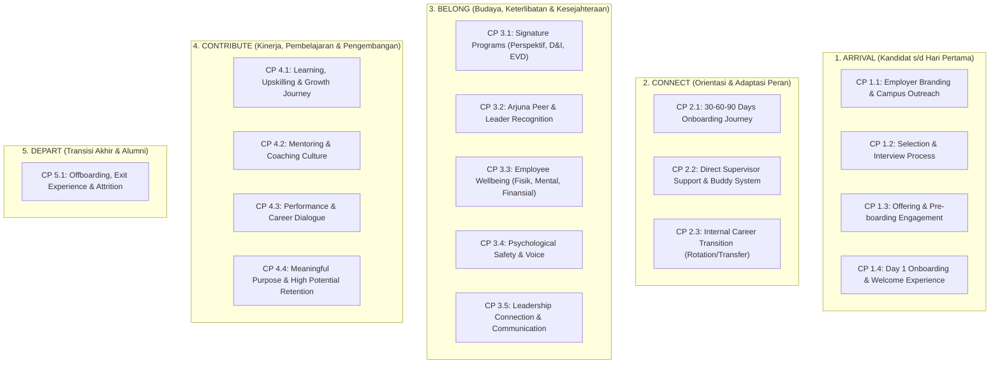

# 01. People Experience Brains & Mathematical Model
**CIMB Niaga People Experience (PX) Framework**

---

## 🧠 1. Filosofi & Fondasi Konseptual

Pengalaman Karyawan (*People Experience / PX*) di PT Bank CIMB Niaga Tbk dibangun berdasarkan visi *"Kejar Mimpi"*, yang menempatkan karyawan sebagai aset utama yang menjalani perjalanan holistik sepanjang masa baktinya di bank.

Sistem People Experience dirancang sebagai **"Measurement & Action Engine"** yang tidak hanya menghitung skor kepuasan secara pasif, melainkan menghubungkan persepsi karyawan (*Survey Sentiment*) dengan data transaksional operasional (*HR Outcomes*) untuk menghasilkan rekomendasi inisiatif perbaikan secara otomatis.

```
       ┌────────────────────────────────────────────────────────┐
       │             CIMB NIAGA PEOPLE EXPERIENCE               │
       │                   INTEGRATED INDEX                     │
       └───────────────────────────┬────────────────────────────┘
                                   │
                  ┌────────────────┴────────────────┐
                  ▼                                 ▼
       ┌─────────────────────┐           ┌─────────────────────┐
       │   SURVEY INDEX      │           │    OUTCOME INDEX    │
       │   Bobot: 70%*       │           │   Bobot: 30%*       │
       │  (Persepsi & Rasa)  │           │   (Data Fakta HR)   │
       └──────────┬──────────┘           └──────────┬──────────┘
                  │                                 │
                  └────────────────┬────────────────┘
                                   │
                                   ▼
        ┌──────────────────────────────────────────────────────┐
        │                 5 EMPLOYEE JOURNEYS                  │
        │      Arrival • Connect • Belong • Contribute • Depart│
        └──────────────────────────────────────────────────────┘
```

\* Bobot default. Sejak v2.48.0 bobot diatur Admin (setting `px_index_weights`), lihat §3.1.

---

## 🗺️ 2. Arsitektur 5 Employee Journeys & 17 Checkpoints

Framework ini memetakan seluruh siklus kerja karyawan ke dalam **5 Tahapan Utama (Journeys)**, yang dipecah menjadi **17 Titik Sentuh Kritis (Checkpoints)** dan diukur melalui **27 Metrik Terstandarisasi**:



---

## 📐 3. Formula Matematika & Model Komputasi

### 3.1 Formula Utama: Konsolidasi PE Index Nasional

Indeks People Experience CIMB Niaga dikalkulasi menggunakan prinsip pembobotan gabungan antara instrumen kualitatif (*Survey*) dan fakta transaksional internal (*Outcome*):

$$\mathbf{PE\ Index} = \left( W_{\text{survey}} \times \mathbf{Index}_{\text{survey}} \right) + \left( W_{\text{outcome}} \times \mathbf{Index}_{\text{outcome}} \right)$$

Dimana secara default:
$$W_{\text{survey}} = 0.70 \quad (70\%), \qquad W_{\text{outcome}} = 0.30 \quad (30\%)$$

$$PE\ Index = 0.70 \times Index_{\text{survey}} + 0.30 \times Index_{\text{outcome}}$$

**Bobot dapat diubah (sejak v2.48.0)**: $W_{\text{survey}}$ dan $W_{\text{outcome}}$ dibaca dari setting `px_app_settings.px_index_weights` (seed `{ "survey": 70, "outcome": 30 }`). Admin mengubahnya di **Admin Parameters -> Journey Parameters -> PX Index Weights** (`PUT /api/admin/settings/px_index_weights`): bilangan bulat 0-100 yang berjumlah 100, selain itu ditolak (400). Bobot yang sama dipakai untuk PX Index dan skor journey (§3.6). Angka 0.70 / 0.30 di dokumen ini adalah nilai default. Engine membaca setting lewat `getPxWeights()` (cache 30 detik per proses); bila nilai tersimpan hilang atau tidak valid dipakai 70/30. `GET /api/metrics/calculate` mengirim bobot yang dipakai sebagai `px_weights` dan `weights_formula`.

**Komponen tanpa data (sejak v2.36.0)**: indeks komponen yang tidak punya satu pun metrik berdata dalam periode terpilih bernilai `null`; bobot Survey/Outcome tidak dipaksakan. `GET /api/metrics/calculate` mengirim `px_index_basis`:

| `px_index_basis` | Kondisi | PX Index |
| :--- | :--- | :--- |
| `BOTH` | Survey Index dan Outcome Index berdata | $W_{\text{survey}} \times Index_{\text{survey}} + W_{\text{outcome}} \times Index_{\text{outcome}}$ (default 0.70 / 0.30) |
| `SURVEY_ONLY` | Tidak ada metrik Outcome aktif | = Survey Index |
| `OUTCOME_ONLY` | Tidak ada metrik survei berdata (mis. tahun depan) | = Outcome Index |
| `NONE` | Keduanya kosong | `null` |

---

### 3.2 Normalisasi Skor Level Pertanyaan (5 Tipe Pertanyaan)

Sistem mendukung 5 tipe input pertanyaan (tipe ke-5 `PERCENTAGE` sejak v2.50.0) pada kuesioner survei. Setiap tipe dinormalisasi ke skala seragam **$0.0\% - 100.0\%$**:

#### 1. Skala 1 s/d 5 (`SCALE_1_5`)
Rating likert 5 skala.
$$\text{Normalized Score}_i = \left( \frac{V_i}{5.0} \right) \times 100\%$$
*Contoh*: Nilai $4.85 \rightarrow \left(\frac{4.85}{5}\right) \times 100 = 97.0\%$.

#### 2. Skala 1 s/d 10 (`SCALE_1_10`)
Rating kepuasan 10 poin (NPS / CSAT).
$$\text{Normalized Score}_i = \left( \frac{V_i}{10.0} \right) \times 100\%$$
*Contoh*: Nilai $8.50 \rightarrow \left(\frac{8.50}{10}\right) \times 100 = 85.0\%$.

#### 3. Biner Ya / Tidak (`YES_NO`)
Jawaban biner berbasis kepatuhan/keberadaan fasilitas.
$$\text{Score}(V_i) = \begin{cases} 100\%, & \text{jika } V_i \in \{\text{'Ya'}, \text{'Y'}, \text{'True'}, \text{'1'}\} \\ 0\%, & \text{jika } V_i \in \{\text{'Tidak'}, \text{'T'}, \text{'False'}, \text{'0'}\} \end{cases}$$
Persentase ketercapaian butir soal $k$ dari $N$ responden:
$$\% \text{Ya}_k = \left( \frac{N_{\text{Ya}}}{N_{\text{Ya}} + N_{\text{Tidak}}} \right) \times 100\%$$

#### 4. Free Text / Kualitatif (`FREE_TEXT`)
Komentar dan saran teks bebas.
- **Sifat Komputasi**: *Non-scorable* (dikecualikan dari penyebut nilai rerata numerik responden agar tidak mendistorsi bobot matematis).
- **Output**: Disimpan sebagai feed verbatim kualitatif untuk analisis sentimen dan referensi AI Action Library.

#### 5. Persentase (`PERCENTAGE`, sejak v2.50.0)
Nilai 0 s/d 100 (%), dipakai apa adanya: $\text{Normalized Score}_i = V_i$. Wajib untuk semua pertanyaan metrik ESS (ringkasan ESS melaporkan setiap pertanyaan dalam persen); boleh dipakai metrik SYSTEM (jawaban CSV 0-100, akhiran `%` diterima, di luar rentang -> baris ditolak).

---

### 3.3 Agregasi Skor Responden Individual

Untuk seorang koresponden $r$ yang mengisi instrumen dengan $K$ butir pertanyaan yang bernilai numerik/scorable ($K_{\text{scorable}} \subseteq K$):

$$\text{Respondent Score}_r = \frac{1}{|K_{\text{scorable}}|} \sum_{k \in K_{\text{scorable}}} \text{Normalized Score}_{r, k}$$

---

### 3.4 Agregasi Skor Metrik ($M_m$)

Skor agregat metrik $m$ diperoleh dari rerata seluruh respon valid yang masuk dalam periode berjalan:

$$\mathbf{Metric\ Normalized\ Score}_m = \frac{1}{N_m} \sum_{r=1}^{N_m} \text{Respondent Score}_r$$

Untuk metrik tipe **Outcome** yang berbasis data persentase langsung (misal: % SLA Fulfilment, % Early Attrition):
$$\mathbf{Metric\ Normalized\ Score}_m = \text{Achieved Percentage} \ (\%)$$

---

### 3.5 Agregasi Skor Checkpoint ($CP_c$)

Setiap checkpoint $c$ menaungi $M_c$ metrik:

$$\mathbf{Checkpoint\ Score}_c = \frac{1}{M_c} \sum_{m=1}^{M_c} \mathbf{Metric\ Normalized\ Score}_m$$

---

### 3.6 Agregasi Skor Journey ($J_j$)

Skor suatu Journey $j$ diperoleh dari rata-rata terbobot atau rata-rata sederhana dari seluruh metrik di dalamnya:

$$\mathbf{Journey\ Score}_j = \sum_{m \in J_j} \left( w_m \times \mathbf{Metric\ Normalized\ Score}_m \right)$$

Dimana $\sum_{m \in J_j} w_m = 1.0$ (secara default bobot terdistribusi merata / *equal weights* antar metrik dalam journey tersebut, kecuali disesuaikan oleh Admin pada menu Bobot Journey).

---

### 3.7 Agregasi Indeks Survei & Indeks Outcome

$$\mathbf{Index}_{\text{survey}} = \frac{1}{|M_{\text{survey}}|} \sum_{m \in M_{\text{survey}}} \mathbf{Metric\ Normalized\ Score}_m$$

$$\mathbf{Index}_{\text{outcome}} = \frac{1}{|M_{\text{outcome}}|} \sum_{m \in M_{\text{outcome}}} \mathbf{Metric\ Normalized\ Score}_m$$

Dimana:
- $|M_{\text{survey}}| = 20$ metrik.
- $|M_{\text{outcome}}| = 7$ metrik.

**Implementasi (`calculatePEIndex()`, sejak v2.36.0)**: kedua rerata di atas adalah rerata berbobot (`weight` per metrik, default 1.0) dan hanya mencakup metrik aktif yang **punya data di jendela periode** (jumlahnya tidak selalu 20/7). Metrik SURVEY tanpa data (`NO_DATA`, §4) tidak masuk pembilang maupun penyebut. Sejak v2.48.0 tidak ada lagi metrik yang dikecualikan filter direktorat: metrik non-karyawan dihitung pada nilai bankwide (§6.1; `is_disabled` / `excluded_from_index` selalu `false`). Aturan yang sama berlaku untuk skor checkpoint (§3.5, rerata berbobot semua metrik berdata) dan journey (§3.6, bobot Survey/Outcome yang sama dengan PX Index per journey, atau satu komponen saja bila komponen lain kosong). Journey/checkpoint tanpa metrik berdata bernilai `null` dengan `has_data: false`.

---

### 3.8 Model Agregasi Skor Butir Pertanyaan ESS (Employee Sentiment Survey)

Untuk 11 metrik survei yang bersumber dari **ESS (Employee Sentiment Survey)**, skor metrik dihitung dari rata-rata persentase respon positif (*% Favorable*) butir-butir pertanyaan dalam dimensi terkait:

$$\mathbf{ESS\ Dimension\ Score}_d = \frac{1}{|Q_d|} \sum_{q \in Q_d} \text{\% Favorable}_q$$

$$\mathbf{Metric\ Normalized\ Score}_{m \in \text{ESS}} = \mathbf{ESS\ Dimension\ Score}_{d(m)}$$

Dimana:
- $Q_d$ adalah himpunan pertanyaan berbobot dalam dimensi $d$.
- $\text{\% Favorable}_q + \text{\% Neutral}_q + \text{\% Unfavorable}_q = 100\%$.
- Setiap pertanyaan memiliki metadata aturan keterlihatan (*visible based on*) dan kewajiban pengisian (*required based on*).

> **Sejak v2.32.0** skor metrik ESS = skor index (kolom F) ringkasan ESS `.xlsx` yang diunggah, bukan rumus di atas. **Sejak v2.50.0** pertanyaan yang ditampilkan selalu pertanyaan di Manage Questions (tipe `PERCENTAGE`); skor per pertanyaan di file dipetakan menurut posisi kolom (G = pertanyaan 1, H = pertanyaan 2, ...). Lihat `docs/04` "Catatan v2.50.0".

---

### 3.9 Skor Bertingkat (Score Tiers) & Metrik N/A (sejak v2.54.0)

Metrik dengan `px_metrics.score_tiers` terisi dinilai per tier, apa pun `scale_type`-nya (`server/db/scoreTiers.js` `tieredScore`, dipanggil `normalizeScore`/`normalizeTarget`). Konfigurasi: `unit` (`percent`|`number`, hanya tampilan/input) dan `bounds` = batas bawah tier 2, 3, 4, 5 dengan operator `>=` atau `>` (batas itu sendiri masuk tier atas atau tidak).

Sejak **v2.54.1** (keputusan user) skor diinterpolasi lurus antar batas sehingga selalu naik seiring nilai ($B_1..B_4$ = batas bawah tier 2..5):

$$\text{Skor}(V) = \begin{cases} \dfrac{V}{B_1}, & \text{tier 1 (di bawah batas tier 2)} \\ t + \dfrac{V - B_{t-1}}{B_t - B_{t-1}}, & \text{tier } t = 2..4 \\ 5, & \text{tier 5} \end{cases} \qquad \text{Normalized Score} = \min\left(100, \max\left(0, \frac{\text{Skor}}{5} \times 100\right)\right)$$

Contoh metrik 14 (batas `>=` 4000/5000/6000/7500): 6400 -> tier 4 -> 4 + (6400 - 6000) / (7500 - 6000) = 4.27 -> **85.33%**; target 5000 -> tier 3 -> 3 / 5 = 60%. (v2.54.0 memakai V / batas bawah x t, yang turun tepat setelah batas - mis. metrik 1: 2,00% -> 80% tetapi 2,01% -> 60,3%; diganti di v2.54.1.)

| Metrik | Unit | Batas tier 2/3/4/5 | Target |
| :--- | :--- | :--- | :--- |
| 1 (engagement rate social media) | % | `>` 1 / `>` 2 / `>` 2.5 / `>` 3.5 | 2% (= 60% sejak v2.54.1; 80% di v2.54.0) |
| 2 (Goes to Campus) | angka | belum diatur (`bounds: null`) -> **N/A** | - |
| 3 (success ratio kandidat universitas target) | % | `>=` 30 / `>=` 45 / `>=` 60 / `>` 75 | 70% (= 93.33%) |
| 14 (penerima recognition / tahun) | angka | `>=` 4000 / 5000 / 6000 / 7500 | 5000 (= 60%) |

**N/A**: metrik bertier dengan `bounds: null` -> `status: NO_DATA`, `not_applicable: true`, nilai/skor/target persen `null`; diperlakukan seperti `NO_DATA` (§4): tidak masuk pembilang maupun penyebut Survey/Outcome/PX Index, rollup journey/checkpoint, alert, dan trend. `score_tiers` `NULL` = normalisasi menurut `scale_type` seperti sebelumnya. Status tetap memakai aturan biasa (< `min_threshold` = CRITICAL, < target persen = WARNING).

---

## ⏳ 4. Model Agregasi Waktu: Period Filter (YTD vs MTD)

Aturan sejak v2.36.0; periode MTD per metrik diubah di v2.37.0; periode ESS diubah lagi di v2.50.0 (*carry-forward*, lihat butir 3). Jendela periode dihitung di `server/db/filterUtils.js` (`ytdEndMonth`, `periodWindow`, `parseFilterOptions`) dan dipakai kedua backend storage (`sqlStorage.buildResponseFilter`, `jsonStorage.applyResponseFilters`), sehingga SQL Server dan JSON membaca baris yang sama.

1. **Year-to-Date (YTD) - default**:
   - Tahun berjalan (jam server): 1 Januari s.d. **akhir bulan berjalan**. Contoh: 19 Okt 2026 -> 2026-01-01 s.d. 2026-10-31. Baris bertanggal setelah bulan ini tidak ikut.
   - Tahun lalu: setahun penuh (Januari-Desember). Tahun depan: jendela kosong (semua metrik SURVEY `NO_DATA`).
   - `endMonth` eksplisit (titik Performance Trend mode YTD) dipakai, tetapi tidak pernah melewati batas di atas.

2. **Month-to-Date (MTD, `YYYY-MM`)**:
   - $D_{\text{filter}} = \{d \in D \mid \text{Format}(d.\text{date}, \text{'YYYY-MM'}) = \text{SelectedMonth}\}$ - hanya bulan itu, untuk setiap metrik SURVEY SYSTEM (Monthly maupun Annual); `period_window.basis` = `MONTH`. Metrik ESS memakai aturan *carry-forward* (butir 3, sejak v2.50.0).

3. **Periode per metrik** (sejak v2.37.0 tidak lagi ditentukan `update_frequency`, yang kembali hanya untuk pengingat e-mail):

   | Jenis metrik | YTD tahun Y | MTD Y-M |
   | :--- | :--- | :--- |
   | SURVEY SYSTEM (Monthly maupun Annual) | Januari s.d. batas YTD | Hanya bulan M |
   | ESS (ringkasan `.xlsx`, `selectEssResult`, sejak v2.50.0) | Hasil **terakhir** dengan tahun-bulan <= bulan akhir YTD (dibatasi jam server), dari tahun mana pun | Hasil **terakhir** dengan tahun-bulan <= Y-M, dari tahun mana pun |
   | OUTCOME tanpa nilai bulanan | Snapshot saat ini (`raw_value`), tanpa filter periode | Sama |
   | OUTCOME dengan nilai bulanan (upload Admin, sejak v2.54.0; bukan metrik 11) | Nilai bulan tersimpan **terakhir** di Januari s.d. batas YTD; tidak ada -> `NO_DATA` | Hanya bulan M; tidak ada -> `NO_DATA` |

   **ESS = *carry-forward* (sejak v2.50.0)**: ESS hanya sekali setahun (November, batas pengingat 25 November), jadi tahun berjalan memakai hasil tahun lalu sampai hasil tahun berjalan diunggah. `NO_DATA` hanya bila tidak ada hasil pada/sebelum akhir periode, atau periodenya belum dimulai (bulan/tahun depan; `essPeriodEndKey` = `null`). `period_window` metrik ESS = jendela periode yang dipilih dengan `basis: 'LATEST_RESULT'`; `ess_period` / `ess_period_label` = periode hasil yang dipakai; `ess_carried_forward` = `true` bila hasil itu sebelum periode yang dipilih (MTD: bulan lain; YTD: tahun sebelumnya). Contoh dengan satu-satunya hasil ESS 2025-11 (metrik 9 = 92 dari file asli): 92 pada MTD 2025-11 dan YTD 2025 (tidak carried), juga pada MTD 2025-12, MTD 2026-01 s.d. 2026-10 dan YTD 2026 (carried); `NO_DATA` pada MTD 2025-10, MTD 2024-12, YTD 2024.

   Riwayat aturan ESS: v2.32.0 carry-forward -> v2.36.0 hanya tahun yang sama -> v2.37.0 hanya bulan template (MTD) -> **v2.50.0 carry-forward lagi** (aturan v2.37.0 dan dummy kuartal 2026-03/06/09 dihapus). Aturan v2.36.0 "metrik Annual pada MTD Y-M = Januari s.d. M" (`effectiveMetricPeriod`) dihapus di v2.37.0. Response menyertakan `period_window = { from, to, basis }` per metrik SURVEY (`MONTH` untuk MTD, `YEAR_TO_MONTH` untuk YTD, `LATEST_RESULT` untuk ESS; OUTCOME `null`).

4. **Status `NO_DATA`**: metrik SURVEY tanpa data di jendelanya -> `has_data: false`, `raw_value` / `normalized_score` / `gap` = `null`, `sample_size` = 0. Tidak ada fallback ke `raw_value` statis (juga untuk metrik 12, yang `raw_value`-nya masih ditulis sinkron feedback event). Metrik ini tidak ikut Survey Index, rollup journey/checkpoint (§3.7) dan alert (§5). Metrik OUTCOME tidak pernah `NO_DATA`.

5. **Performance Trend (`computeMonthlyTrends`)**:
   - Hanya bulan yang sudah lengkap (s.d. bulan lengkap terakhir); mode YTD = kumulatif Januari tahun titik itu s.d. bulan titik, mode MTD = per bulan. Setiap titik dihitung dengan `calculatePEIndex()` yang sama dengan scorecard, jadi aturan 1-4 berlaku per titik.
   - Titik tanpa data survei: `survey_index` dan `px_index` = `null` (celah di grafik), bukan PX dari Outcome saja.

---

## 🚨 5. Alert & Deficit Detection Engine

Sistem mengimplementasikan deteksi anomali kinerja secara real-time untuk setiap metrik $m$:

```
      Normalized Score (%)
               │
      100% ────┼───────────────────────────
               │  🟢 EXCELLENT / ON TARGET
       80% ────┼─────────────────────────── [Target Batas Aman: >= 80%]
               │  🟡 WARNING / WATCHLIST
       75% ────┼─────────────────────────── [Ambang Toleransi / Min Threshold: 75%]
               │  🔴 CRITICAL DEFICIT
        0% ────┴───────────────────────────
```

### Logika Klasifikasi Status:
1. **On Target (Hijau)**: $\text{Normalized Score}_m \ge \text{Target Value}$ (Default $\ge 80.0\%$).
2. **Warning / Needs Attention (Kuning)**: $\text{Min Threshold} \le \text{Normalized Score}_m < \text{Target Value}$ ($75.0\% \le \text{Score} < 80.0\%$).
3. **Critical Deficit (Merah)**: $\text{Normalized Score}_m < \text{Min Threshold}$ ($< 75.0\%$).
   - Memicu pembuatan entri pada **Pusat Peringatan & Defisit Kinerja PE** (`/api/alerts`).
   - Otomatis menghubungkan metrik yang defisit ke **Action Library** untuk memunculkan inisiatif perbaikan berbasis AI dan SOP internal CIMB Niaga.
4. **No Data (abu-abu, sejak v2.36.0)**: metrik SURVEY tanpa data di periode terpilih (`status: 'NO_DATA'`, skor `null`). Tidak dibandingkan dengan target/threshold dan tidak pernah memicu alert (`alertEngine.js` melewati metrik dengan `has_data === false`).

---

## 🏛️ 6. Filter Direktorat & Metrik Non-Karyawan

### 6.1 Aturan sejak v2.48.0: metrik non-karyawan dihitung pada nilai bankwide

Permintaan user (2026-10-20): nilai sebuah direktorat = metrik direktorat itu + metrik yang hanya ada bankwide. Berlaku untuk setiap filter direktorat/divisi (Admin) dan setiap cakupan User (`scopes`), di `calculatePEIndex()`, `getMetricDetail()`, `alertEngine.js` dan `GET /api/metrics/by-directorate`:

1. **Metrik karyawan** (`is_employee_metric` true, #6-#27) dibaca dari data unit/cakupan yang difilter (tidak berubah).
2. **Metrik non-karyawan** (`is_employee_metric === false`, #1-#5: Career Website Traffic, Goes to Campus Evaluation, University Success Ratio, Channel Success Ratio, Candidate Experience Score) tidak punya data per direktorat, jadi dibaca pada **nilai bankwide**: SURVEY = respons bankwide (filter direktorat/divisi/cakupan diabaikan, periode tetap), ESS = baris Bankwide, OUTCOME = snapshot bankwide. Metrik ini ditandai `is_bankwide_value: true`.
3. Metrik non-karyawan **ikut dihitung** di Survey Index, Outcome Index, checkpoint, journey dan alert:

   $$PX_{dir} = W_{\text{survey}} \times \overline{S}_{dir} + W_{\text{outcome}} \times \overline{O}$$

   dengan $\overline{S}_{dir}$ = rerata berbobot metrik SURVEY berdata (metrik karyawan direktorat + metrik non-karyawan pada nilai bankwide) dan $\overline{O}$ = rerata berbobot metrik OUTCOME (snapshot bankwide, sehingga Outcome Index di bawah filter = Outcome Index bankwide).
4. Aturan `NO_DATA` (§4) dan `px_index_basis` (§3.1) tidak berubah.
5. `is_disabled` dan `excluded_from_index` tetap ada di payload untuk kompatibilitas tetapi selalu `false` (`disabled_reason` = `null`, `disabled_metrics_count` = 0); `bankwide_value_metrics_count` = jumlah metrik `is_bankwide_value`.
6. **Sejak v2.51.0, hanya di `GET /api/metrics/by-directorate`**: direktorat tanpa data sendiri - tidak ada metrik SURVEY berdata selain nilai bankwide (baris SYSTEM atau hasil ESS direktorat itu) - mendapat `has_own_data: false`, PX/Survey/Outcome Index `null`, `px_index_basis` `NONE` dan tidak diperingkat. Tanpa aturan ini direktorat baru yang kosong akan tampil dengan PX dari metrik #1-#5 dan snapshot OUTCOME saja. `GET /api/metrics/calculate?directorate=` tidak berubah.

Dampak YTD 2026 (laporan developer, PX / Outcome): Business Banking 83.28 / 70.13 -> 84.83 / 75.08, Human Resources 83.61 / 70.13 -> 85.13 / 75.08, Sharia Banking 84.98 / 70.13 -> 86.30 / 75.08; bankwide tidak berubah (85.27). Sebelum v2.48.0 Admin melihat metrik #1-#5 dikecualikan (§6.2) dan User (sejak v2.26.0) melihatnya sebagai nilai bankwide read-only yang tidak dihitung (`excluded_from_index`).

### 6.2 Aturan lama: eksklusi dinamis (v2.9.0 s/d v2.47.0) - TIDAK BERLAKU LAGI

> Digantikan §6.1 sejak v2.48.0. Teks di bawah hanya catatan sejarah.

Ketika sistem difilter berdasarkan **Direktorat atau Sub-Direktorat** tertentu (bukan *All / Bankwide*), metrik non-karyawan dieksklusikan secara dinamis:

1. **Klasifikasi Metrik**:
   - **Internal Employee Metrics ($M_{\text{emp}}$)**: Metrik #6 s/d #27 (misal: Pre-boarding, Day 1 Onboarding, Onboarding 30/60/90, 11 Dimensi ESS, Training Attendance, Promotion Rate, Turnover Rate, Exit Survey).
   - **External / Non-Employee Metrics ($M_{\text{ext}}$)**: Metrik #1 s/d #5 (Career Website Traffic, Goes to Campus Evaluation, University Success Ratio, Channel Success Ratio, Candidate Experience Score).

2. **Formulasi Normalisasi Bobot Dinamis**:
   Untuk journey $j$ yang memiliki subset metrik aktif $M_{j, \text{active}} \subseteq M_j$ yang relevan dengan karyawan direktorat:
   $$w_{m, \text{normalized}} = \frac{w_m}{\sum_{k \in M_{j, \text{active}}} w_k}$$

   $$\mathbf{Journey\ Score}_j = \sum_{m \in M_{j, \text{active}}} \left( w_{m, \text{normalized}} \times \mathbf{Score}_m \right)$$

   Untuk metrik non-karyawan yang dinonaktifkan:
   - Diberi status `is_disabled = true` dan `disabled_reason = "Non-employee external metric excluded from directorate view"`.
   - Ditampilkan dengan warna abu-abu (*muted grey*) dan tidak dapat diklik (*unclickable*).
   - Seluruh metrik aktif dalam Journey 1 s/d 5 menggulung ke total **People Experience Index** dengan bobot 70% Survey dan 30% Outcome secara proporsional.

