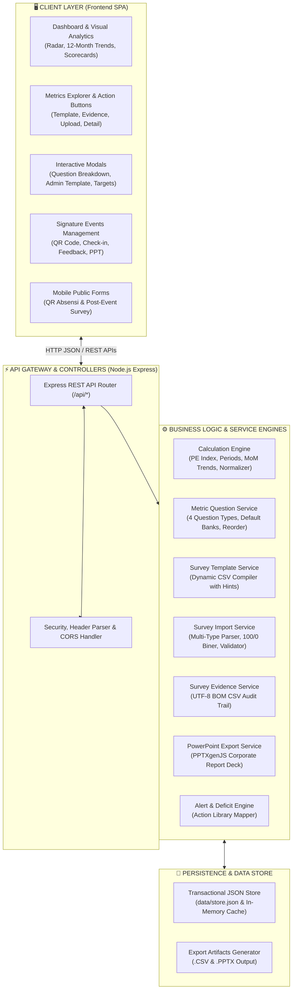
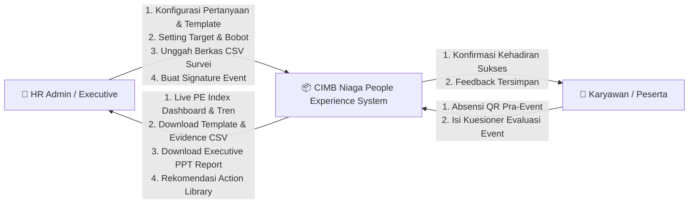

# 03. System Architecture & Data Flow
**CIMB Niaga People Experience (PE) Framework**

---

## 🏛️ 1. Arsitektur Sistem (High-Level Architecture)

Sistem People Experience CIMB Niaga dirancang dengan arsitektur **Modern Single-Page Application (SPA) terintegrasi dengan RESTful Micro-Services Backend** yang beroperasi secara mandiri (*standalone on-premise*) tanpa ketergantungan pada layanan cloud pihak ketiga:



---

## 🔄 2. Data Flow Diagram (DFD)

### 2.1 DFD Level 0: Context Diagram



---

### 2.2 DFD Level 1: Dekomposisi Proses Utama

```mermaid
flowchart TD
    subgraph P1["Proses 1.0: Real-time PE Calculation"]
        D1[("Database Store")] -->|Ambil Respon & Target| P1_Calc[Kalkulasi Normalisasi 70/30]
        P1_Calc -->|Period Filter: YTD / YYYY-MM| P1_Out[JSON Skor Konsolidasi, Radar & Tren]
    end

    subgraph P2["Proses 2.0: Dynamic CSV Template & Question Builder"]
        Admin_Req[Request Template Metrik] --> P2_Gen[Baca Konfigurasi 4 Tipe Pertanyaan]
        P2_Gen --> P2_Compile[Kompilasi Header & Sample Row]
        P2_Compile -->|Stream CSV| Admin_DL[Unduh File Template .csv]
    end

    subgraph P3["Proses 3.0: Survey CSV Bulk Import Engine"]
        Upload_File[File CSV Diunggah] --> P3_Parse[Parser Delimiter & Sanitizer]
        P3_Parse --> P3_Val[Validasi NIP, Metric ID & Tipe Jawaban]
        P3_Val -->|Valid| P3_Save[Simpan Respon ke Store & Kalkulasi Ulang]
        P3_Val -->|Invalid| P3_Err[Laporan Baris Gagal & Alasan Error]
    end

    subgraph P4["Proses 4.0: Event Management & PPT Generator"]
        Event_Form[Peserta Submit Rating Event] --> P4_Store[Catat Skor Evaluasi]
        P4_Store --> P4_PPT[PPTXgenJS Compile Slides & Charts]
        P4_PPT --> PPT_File[Unduh Executive Report .pptx]
    end
```



---

## 🔄 3. Siklus Hidup Data Survei (Survey Data Lifecycle)

```
   ┌──────────────────────┐
   │ 1. KONFIGURASI ADMIN │ ──> Admin menyusun butir soal & tipe jawaban di Admin Modal
   └──────────┬───────────┘
              │
              ▼
   ┌──────────────────────┐
   │ 2. GENERATE TEMPLATE │ ──> Sistem menghasilkan berkas CSV dengan header pertanyaan spesifik
   └──────────┬───────────┘
              │
              ▼
   ┌──────────────────────┐
   │ 3. PENGISIAN DATA    │ ──> HR mendistribusikan / mengisi CSV respon karyawan
   └──────────┬───────────┘
              │
              ▼
   ┌──────────────────────┐
   │ 4. VALIDASI & IMPORT │ ──> Parser memverifikasi NIP, normalisasi Ya/Tidak (100/0) & skala
   └──────────┬───────────┘
              │
              ▼
   ┌──────────────────────┐
   │ 5. REKALKULASI INDEX │ ──> PE Index, radar chart, skor journey, dan tren bulanan ter-update
   └──────────┬───────────┘
              │
              ▼
   ┌──────────────────────┐
   │ 6. AUDIT EVIDENCE    │ ──> Tim HR dapat mengekspor berkas audit CSV berstempel tanggal
   └──────────────────────┘
```

---

## 🔒 4. Keamanan, Kepatuhan On-Premise & Integritas Data

1. **Zero External Dependency (On-Premise Ready)**:
   - Seluruh backend berjalan di lingkungan intranet Bank tanpa memerlukan koneksi internet aktif atau layanan cloud SaaS.
2. **Validasi Karyawan Berbasis NIP**:
   - NIP diverifikasi pada setiap baris data survei maupun absensi event untuk memastikan tidak terjadi duplikasi respon dari karyawan yang sama dalam satu periode penilaian.
3. **Standar Berkas CSV UTF-8 BOM**:
   - Berkas CSV ekspor (baik template maupun evidence) menggunakan encoding UTF-8 dengan Byte Order Mark (`\uFEFF`) guna memastikan kompatibilitas sempurna saat dibuka di Microsoft Excel versi desktop perbankan tanpa merusak karakter khusus atau format kolom.
4. **Resiliency & Fallback Column Matching**:
   - Parser impor survei dilengkapi algoritma *fuzzy header matching* yang tetap mengenali kolom pertanyaan baik berdasarkan nama *key* unik (`q1_recruitment_process`) maupun urutan nomor urut (`q1`, `q2`, `q3`, dst.).
   - **Client-side Retry untuk Race Kondisi Start-up Dev Server (`src/utils/fetchWithRetry.js`, sejak v2.19.0)**: `npm run dev` menjalankan backend Express (port 5000) dan frontend Vite (port 3000) secara bersamaan tanpa readiness handshake, sehingga fetch pertama yang ditembak begitu Dashboard dimuat (`App.jsx`'s data awal, `TrendChart.jsx`'s data tren) berpotensi mendarat sebelum backend selesai boot dan gagal total (`TypeError: Failed to fetch`) alih-alih mendapat respons HTTP. `fetchWithRetry()` membungkus `fetch()` bawaan dengan retry otomatis (hingga 4x, jeda 600ms) saat request gagal total atau server membalas 502/503/504, sehingga jendela race start-up ini pulih sendiri tanpa menampilkan error mentah ke pengguna.
5. **Sub Agent "Auditor" — Audit Data Dummy/Hardcode (`.claude/agents/auditor.md`)**:
   - Persona *read-only* untuk memeriksa codebase secara berkala dan mendeteksi nilai yang dibekukan (hardcoded) dalam logika bisnis (`server/services/*.js`) yang seharusnya bersumber dari database (`server/db/storage.js` / `store.json`), parameter admin yang dapat diedit, atau jam server real-time — dibedakan secara eksplisit dari `server/db/seedData.js` yang memang sengaja berisi data seed/demo statis (bukan bug). Jalankan lewat Agent tool dengan membaca instruksi di `.claude/agents/auditor.md` sebagai brief. Temuan pertama (2026-09-18, lihat `CHANGELOG.md` **[2.12.0]**): peta tanggal ingestion Outcome yang hardcoded di kode dipindah menjadi field database `last_data_date`, tahun `'2026'` yang dibekukan di banyak tempat diganti turunan jam server, dan agregasi verbatim alert yang hanya mengambil dari 1 event ID hardcoded diperluas ke seluruh event di database.

---

## 🗄️ Lapisan Penyimpanan: JSON Store & Microsoft SQL Server (v2.22.0)

Persistensi kini dapat dipilih lewat `STORAGE_BACKEND` di `.env`: `json` (default; `server/data/store.json` + cache memori, node "Transactional JSON Store" pada diagram di atas) atau `sql` (**Microsoft SQL Server lokal**, database `PeopleExperiencePX`, tanpa cache — setiap pembacaan = query). `server/db/storage.js` hanya dispatcher; semua pemanggil memakai `await storage.x()` sehingga kontrak kedua backend identik. Foto & video Signature Event **tidak** masuk database: file tetap di `server/uploads/`, database menyimpan path + metadata + transkrip AI. Tetap 100% on-premise (SQL Server berjalan di mesin yang sama; login aplikasi `px_app` hanya `db_owner` database itu). Skema, migrasi, rollback, dan operasional: lihat **`docs/08_DATABASE_SCHEMA_AND_MIGRATION.md`**.

---

## 🔐 Alur Login & Sesi (v2.26.0)

```
Browser --POST /api/auth/login {username,password}--> authService
   |                                   | scrypt verify (+ hash tiruan bila user tak ada)
   |                                   | gagal >=5x -> akun dikunci 15 menit; >20 gagal/menit/IP -> 429
   |<-- Set-Cookie px_session=<token acak> (httpOnly, SameSite=Strict, Secure bila HTTPS) --
   |                                   px_sessions menyimpan SHA-256(token) + expires_at (8 jam)
Browser --GET /api/... (cookie otomatis)--> authGate: cookie -> hash -> px_sessions -> px_users
                                           tanpa sesi valid -> 401 (UI kembali ke halaman login)
```

- **Satu gerbang**: `registerAuthRoutes()` memasang `authGate` pada `/api` sebelum rute lain. Hanya 6 rute publik yang lolos tanpa sesi (health, login, daftar direktorat, `events/by-code`, absensi dan feedback event) — yang dipakai form check-in/feedback publik. `/api/admin/*` hanya ADMIN; `/uploads` dan `/exports` juga wajib login.
- **Role**: `ADMIN` (semua data, semua menu admin) dan `USER` (terikat pada cakupan data yang diatur Admin, lihat di bawah). Penegakan ada di **server**; UI hanya menyembunyikan menu yang tidak bisa dipakai.
- **Cakupan data USER (v2.27.0)**: daftar `[{ directorate, divisions }]` di `px_user_scopes` (`divisions: null` = semua divisi), diatur Admin per User dan dinormalisasi oleh `scopeUtils.js`. `authService.resolveScope()` menyempitkan permintaan ke cakupan: direktorat kosong/`ALL` = **semua cakupan saya** (data gabungan, di-pool lewat pipeline scorecard yang sama — sampel = jumlah, rata-rata terbobot sampel, bukan rata-rata dari rata-rata); direktorat/divisi di luar cakupan → 403 (`calculate`, `trends`, `:id/detail`, `alerts`). Divisi kini ikut membatasi. Alert (skor + komentar verbatim) dan absensi/feedback event non-pengelola dihitung/ditampilkan dari responden dalam cakupan saja. Metrik non-karyawan/OUTCOME tetap agregat bankwide read-only dan tidak masuk indeks cakupan. Cakupan dibaca ulang tiap request, jadi perubahan oleh Admin berlaku tanpa mematikan sesi.
- **PIC metrik (v2.27.1)**: akun `USER` aktif adalah PIC metrik survei M bila emailnya sama dengan `pic_email` M (Admin Parameters, dulu Parameter Admin; tanpa beda huruf, di-`trim`; setiap metrik SURVEY sejak v2.29.0 - SYSTEM atau ESS, ber-flag `requires_manual_upload` atau tidak; sebelumnya hanya yang ber-flag). Hak dibaca dari database tiap request (berlaku langsung). PIC boleh memakai template, upload, riwayat, evidence, dan daftar responden **hanya untuk metrik miliknya**; identitas responden metrik karyawan hanya baris dalam cakupan direktorat/divisi akunnya, metrik non-karyawan bankwide. Hasil upload PIC tidak memuat kalkulasi PE Index bankwide. Upload dicatat sebagai audit `SURVEY_UPLOAD`; file CSV sementara dihapus setelah impor.
- **Data responden**: `redactRespondent()` menelusuri seluruh payload (termasuk daftar bersarang seperti `verbatim_samples`) dan mengosongkan `nip`, `employee_name`, `cimb_email`, `email`, `participant_*`, `candidate_*`. Evidence CSV dan `GET /api/surveys/responses/:metric_id` → 403 untuk non-Admin kecuali PIC metrik tersebut (lihat butir PIC di atas).
- **Signature Event**: baca untuk semua yang login; tulis hanya Admin + User yang cakupannya memuat direktorat di setting `event_manager_directorates` (divisi apa pun). Non-pengelola tidak menerima kode akses check-in/feedback dan data absensi/feedback per orang disamarkan.
- **Ganti password wajib**: akun dengan `must_change_password` hanya bisa mengakses `/api/auth/me|logout|change-password` (selain itu 403 `PASSWORD_CHANGE_REQUIRED`).
- **Penyimpanan**: SQL -> `px_users`, `px_user_scopes`, `px_sessions`, `px_audit_log`; JSON -> `server/data/auth.json` (git-ignored). Lihat `docs/08` §9.
- **Kepatuhan**: login lokal sepenuhnya on-premise (tanpa layanan identitas eksternal). Secret (hash password, hash token) tidak pernah dikembalikan API maupun dicatat di log. Untuk produksi, taruh di belakang reverse proxy HTTPS dan set `TRUST_PROXY`. Proxy dev Vite sengaja **tanpa** `changeOrigin` supaya pemeriksaan `Origin` vs `Host` (pertahanan CSRF) tidak menolak request dari `localhost:3000`.

---

## 🤖 Aturan Produk AI Lokal & Alur AI Summary Video (v2.28.0)

**Aturan produk**: model lokal (Gemma 3 4B via Ollama, `http://localhost:11434`) dipakai untuk **satu hal saja** — ringkasan transkrip video Signature Program Event. Analisis metrik WARNING/CRITICAL direncanakan sebagai langkah berikutnya, belum ada. Semua pemrosesan on-premise: transkrip dan prompt tidak keluar dari mesin.

| Boleh memanggil Gemma | Tidak pernah memanggil Gemma |
| :--- | :--- |
| Video **baru** setelah transkrip `DONE` | GET event, dashboard, alerts, `/api/health` (tanpa `?check_ai=1`), upload/tampil foto, generate PPT |
| Tombol manual **Buat / Buat ulang ringkasan** (pengelola event: Admin/HR) | Boot server, kecuali melanjutkan ringkasan yang terputus saat `PROCESSING` (video lama tanpa ringkasan tidak disentuh) |

Penjaga tunggal: `localAiService.assertAiAllowed()` — `queryLocalOllama()` menolak panggilan tanpa scope `EVENT_VIDEO_SUMMARY` dan subjek berupa video yang punya transkrip.

```text
Upload video -> transcribeService (API lokal :8000) -> transcript_status DONE
   -> queueMediaSummary -> aiQueue (satu job, kunci media:<id>)
   -> mediaSummaryService: <20 kata? INSUFFICIENT (tanpa model)
        -> prompt (dipecah 5000 karakter bila panjang) -> Ollama
        -> parse RINGKASAN:/POIN: -> validateAnswer
             lolos   -> summary_source AI
             ditolak -> retry 1x (alasan dimasukkan ke prompt) -> ditolak lagi / Ollama gagal
                     -> ringkasan ekstraktif aturan (summary_source RULE)
   -> px_media.summary_* (SQL Server) -> UI polling 4 dtk -> slide media PPT membaca dari DB
```

Narasi Score Deficit Alert dan Event Summary kini murni aturan (tidak lagi mencoba Ollama). Ringkasan yang ditampilkan wajib berlabel sumbernya (`AI` atau "Otomatis (aturan)") dan UI mengingatkan agar dicek dengan transkrip.
