# 05. Frontend UI & Component Hierarchy
**CIMB Niaga People Experience (PX) Framework**

---

## 🎨 1. Arsitektur Frontend & Tech Stack

Antarmuka pengguna People Experience dibangun menggunakan ekosistem **React 19, Vite, Tailwind CSS v4, dan Lucide React** dengan antarmuka 100% berbahasa Inggris (*Full English Localization*) untuk menghadirkan performa rendering kilat, responsivitas tinggi, serta estetika korporat modern khas perbankan (*CIMB Corporate Identity & Official Emblem*).

```
📁 src/
├── 📄 main.jsx                              # Mount Point React DOM
├── 📄 App.jsx                               # Root Component, State Global & Navigation
├── 📄 index.css                             # Tailwind Directives & Custom Corporate Theme
└── 📁 components/                           # Komponen Antarmuka Terisolasi (100% English UI)
    ├── 📄 CimbLogo.jsx                      # Official CIMB Niaga Corporate Emblem & Typography
    ├── 📄 Header.jsx                        # Top Navigation, Period Selector & Admin Action Toolbar
    ├── 📄 Dashboard.jsx                     # Executive Scorecards, Journey Cards & Deficit Interventions
    ├── 📄 TrendChart.jsx                    # Interactive 12-Month Performance Trend Chart (SVG)
    ├── 📄 DirectoratePxPanel.jsx            # PX Index by Directorate, collapsible (v2.48.0)
    ├── 📄 Calculator.jsx                    # Metrics Table, Freeze Sticky Actions, Scroll Controls
    ├── 📄 EventManager.jsx                  # Signature Programs Event Management, QR & PPT Generator
    ├── 📄 ActionLibraryView.jsx             # PX Action Library & Best Practice Interventions
    ├── 📄 MetricDetailModal.jsx             # Metric Drilldown, ESS Dimensions & Audit Log Modal
    ├── 📄 AdminSurveyQuestionsModal.jsx     # Admin Survey Questions & Multi-Type Questions Engine
    ├── 📄 AdminSettingsModal.jsx            # Admin Target & Minimum Threshold Settings Modal
    ├── 📄 WeightsModal.jsx                  # Dynamic Weights & Consolidation Settings Modal
    ├── 📄 SurveyImportModal.jsx             # Survey Data Center & Bulk CSV Drag-and-Drop
    ├── 📄 CreateEventModal.jsx              # Signature Event Creation & Custom Question Modal
    ├── 📄 QrCodeModal.jsx                   # QR Code Distribution & Sharing Modal
    ├── 📄 PublicCheckInForm.jsx             # Public Mobile QR Attendance Check-In Form
    ├── 📄 PublicFeedbackForm.jsx            # Public Mobile Post-Event Evaluation Survey Form
    └── 📄 ErrorBoundary.jsx                 # Crash Fallback & Reload Boundary Component
```

---

## 🌳 2. Pohon Hirarki Komponen (Component Tree)

```mermaid
graph TD
    App["App.jsx (Root Component & Global State)"]
    
    %% Top Navigation
    App --> Header["Header.jsx<br/>(Official CIMB Logo, Period Selector: YTD/Monthly, Admin Nav)"]
    Header --> CimbLogo["CimbLogo.jsx (Official Red Emblem & Brand Typography)"]
    
    %% Main Views
    App --> MainView{"View Mode Selector"}
    MainView -->|Tab: Dashboard| Dashboard["Dashboard.jsx<br/>(Scorecards, Journey Cards, Deficit Alerts)"]
    Dashboard --> TrendChart["TrendChart.jsx<br/>(Trend SVG Chart: PX, Survey & Outcome; weights from px_index_weights)"]
    Dashboard --> DirPanel["DirectoratePxPanel.jsx<br/>(PX Index by Directorate, v2.48.0)"]
    MainView -->|Tab: Calculator| Calculator["Calculator.jsx<br/>(Sticky Action Column, Density View, Date Badges)"]
    MainView -->|Tab: Events| EventManager["EventManager.jsx<br/>(Signature Programs, QR Codes, PPT Export)"]
    MainView -->|Tab: Action Library| ActionLib["ActionLibraryView.jsx<br/>(Deficit Improvement Action Catalog)"]
    MainView -->|Tab: Exit Interview| ExitDash["ExitInterviewDashboard.jsx (v2.38.0, lazy)<br/>(6 Cards + Themes A/B, Admin Upload/Export)"]
    
    %% Modals Layer
    App --> ModalDetail["MetricDetailModal.jsx<br/>(ESS Dimensions Breakdown & Respondent Logs)"]
    App --> ModalAdminQ["AdminSurveyQuestionsModal.jsx<br/>(Survey Template Editor: Scale 1-5, 1-10, Yes/No, Free Text, Percentage)"]
    App --> ModalTarget["AdminSettingsModal.jsx<br/>(Target & Minimum Threshold Settings)"]
    App --> ModalWeight["WeightsModal.jsx<br/>(Dynamic Metric & Journey Weight Settings)"]
    App --> ModalImport["SurveyImportModal.jsx<br/>(Data Center, CSV Specs & Recalculation)"]
    App --> ModalCreateEv["CreateEventModal.jsx<br/>(New Signature Event & Custom Questions)"]
    App --> ModalQr["QrCodeModal.jsx<br/>(QR Code Viewer & Link Generator)"]

    %% Public Participant Layer
    App --> PublicCheckIn["PublicCheckInForm.jsx (Mobile Pre-Event QR Attendance)"]
    App --> PublicFeedback["PublicFeedbackForm.jsx (Mobile Post-Event Evaluation Survey)"]
```



---

## 🎛️ 3. Deskripsi & Fungsionalitas Komponen Utama

### 3.1 Root Orchestrator ([`src/App.jsx`](file:///d:/Mul/Project/Anti%20Gravity/People%20Experience/src/App.jsx))
- **State Management**:
  - `selectedPeriod`: Menyimpan filter periode aktif (`'YTD'`, `'2026-01'`, `'2026-02'`, dst.).
  - `activeTab`: Navigasi antar tampilan utama (sejak v2.49.0 urutan *Dashboard & Trends, Explore Metrics, Exit Interview, Action Library & AI Alerts, Signature Program Events, About*, hanya menu yang diizinkan `menu_access`; lihat "Catatan v2.49.0").
  - `selectedMetric`: Mengontrol metrik yang sedang dibuka pada *MetricDetailModal*.
  - `isSurveyQuestionsModalOpen`, `isSettingsModalOpen`, `isWeightsModalOpen`, `isImportModalOpen`: Mengontrol visibilitas modal admin dan impor data.
- **Data Fetching Reactive Hook**: Otomatis memicu pemanggilan ulang `/api/metrics/calculate?period=...` setiap kali filter periode berubah atau data baru berhasil diunggah.

---

### 3.2 Header & Kontrol Periode ([`src/components/Header.jsx`](file:///d:/Mul/Project/Anti%20Gravity/People%20Experience/src/components/Header.jsx))
- Menyajikan logo resmi CIMB Niaga via [`CimbLogo.jsx`](file:///d:/Mul/Project/Anti%20Gravity/People%20Experience/src/components/CimbLogo.jsx) dan identitas *"People Experience (PX)"* di baris pertama sebelah kiri.
- **Info user + Sign out di pojok kanan atas (sejak v2.30.0)**: baris pertama Header = brand (kiri) dan, bila ada user login, `username · Role` + nama (Admin) / direktorat (User; "N directorates" bila lebih dari satu cakupan) + tombol **Sign out** (kanan; dulu tombol "Keluar" ada di baris filter). Layar < 640px (`sm`): hanya avatar + tombol ikon. Fungsi logout (`useAuth().logout`) tidak berubah.
- **Dropdown Filter Periode**: Memilih secara instan antara tampilan akumulatif *Year-to-Date (YTD)* atau bulan berjalan (*Month-to-Date*). Dropdown **Tahun** kini diisi secara dinamis dari `available_years` pada response `/api/metrics/calculate` (bersumber dari `storage.getAvailableSurveyYears()` — tahun yang benar-benar punya data survei di database), bukan lagi daftar statis `['2026', '2025']` di kode frontend.
- **Tombol Aksi Cepat Admin**:
  - 📊 **Admin Parameters** (dulu Parameter Admin): Membuka `AdminParametersModal` (parameter journey/metrik, target, threshold, bobot).
  - 📝 **Survey Templates**: Membuka *AdminSurveyQuestionsModal*.
  - ✉️ **Email Settings** (dulu Setting Email): Membuka `EmailSettingsModal`.
  - 👥 **Manage Users** (dulu Kelola User): Membuka `UserManagementModal`.
  - 🎨 **Theme** (dulu Tema): Pemilih warna aksen per-browser (§4.1).
  - Keempat tombol Admin hanya tampil untuk role Admin (`isAdmin`). Pada lebar <= 500px select Directorate tidak lagi tumpang tindih (`min-w-0 max-w-full`).
- **Footer (v2.52.2)**: kiri = "© <tahun> PT Bank CIMB Niaga Tbk. People Experience Framework." + versi aplikasi dari `GET /api/health` (mis. v2.52.2); tagline "Internal HR Confidential System • 100% On-Premise Compliant" dihapus.
- **Filter Sub-Dir dihapus (v2.52.2)**: Header tidak lagi punya dropdown Sub-Dir (divisi); `filterOptions.sub_directorate` selalu `ALL`. Backend tetap mendukung `?sub_directorate=` dan cakupan User per divisi tetap ditegakkan di server.
- **Dropdown bulan (sejak v2.30.0)**: hanya nama bulan Inggris tanpa angka (`January` ... `December`, dari `src/utils/months.js`); nilai internal tetap `01`..`12`. Pada mode YTD opsi pertama "All Months (YTD)".

---

### 3.3 Executive Dashboard & Trend Performance ([`src/components/Dashboard.jsx`](file:///d:/Mul/Project/Anti%20Gravity/People%20Experience/src/components/Dashboard.jsx))
- **Executive Scorecards**:
  - Skor Konsolidasi **PX Index (100%)** beraksen Primary Red (`#ED1C24` / `#FF0000`) dengan indikator delta dan status pencapaian target.
  - Skor **Survey Index (bobot default 70%; sejak v2.48.0 dari setting `px_index_weights`)** beraksen Digital Teal (`#16C0B7` / `#0D9488`).
  - Skor **Outcome Index (bobot default 30%; sejak v2.48.0 dari setting `px_index_weights`)** beraksen Royal Blue (`#2563EB` / `text-blue-400`), terbedakan secara kontras tinggi dari warna merah PX Index.
  - Total Partisipasi Sampel Responden.
- **Grafik Tren Performa 12 Bulan ([`src/components/TrendChart.jsx`](file:///d:/Mul/Project/Anti%20Gravity/People%20Experience/src/components/TrendChart.jsx))**:
  - **Sumbu Y dinamis (sejak v2.48.0, menggantikan skala tetap 0% – 100%)**: sumbu mengikuti nilai terendah/tertinggi yang diplot pada rentang terpilih, dibatasi 0-100; rincian di "Catatan v2.48.0".
  - **Diferensiasi Warna Garis**:
    - **PX Index (100%)**: Garis merah tebal 3.5px (`#ED1C24`).
    - **Survey Index (bobot dari setting, default 70%)**: Garis hijau toska (*Digital Teal*) 2.5px (`#16C0B7`).
    - **Outcome Index (bobot dari setting, default 30%)**: Garis biru royal (*Royal Blue*) 2.5px (`#2563EB`).
    - **Target Benchmark (85.0%)**: Garis putus-putus merah marun (*Deep Maroon*) 1.5px (`#780000`).
  - **Hanya Menampilkan Bulan yang Benar-Benar Lengkap**: Grafik **tidak lagi memuat bulan kalender yang sedang berjalan atau setelahnya sama sekali** (tidak sekadar diberi warna pudar seperti versi sebelumnya) — jika hari ini September 2026, array data hanya berisi 8 titik (Januari–Agustus), titik ke-9 (September) dst. tidak ada. Tahun mengikuti tahun berjalan (tidak lagi dibekukan ke 2026).
  - **Filter Rentang Periode — Bisa Lintas Tahun (Dari Tahun+Bulan / Sampai Tahun+Bulan)**: Dua pasang dropdown Tahun+Bulan (bukan cuma Bulan) di atas grafik untuk mempersempit tampilan ke rentang periode tertentu — termasuk rentang yang **melewati batas tahun**, mis. "November 2025 s/d Februari 2026". Default **Januari s/d bulan lengkap terakhir tahun berjalan**. Opsi Tahun diambil dari `available_years` (data sungguhan di database); opsi Bulan dibatasi otomatis hanya sampai bulan lengkap terakhir tahun yang dipilih — tidak mungkin memilih bulan yang belum selesai, di tahun manapun. Judul chart dan label sumbu-X (mis. "Nov '25") menyesuaikan otomatis saat rentang lintas tahun aktif. Tombol **"Reset"** muncul saat rentang diubah dari default.
  - **Mode YTD Reset per Tahun pada Rentang Lintas Tahun**: Saat rentang lintas tahun aktif dengan mode YTD, kurva kumulatif **reset tiap 1 Januari** (konvensi pelaporan YTD standar) — bukan satu akumulasi menerus lintas tahun.
  - **Fetch Mandiri**: `TrendChart.jsx` kini melakukan `fetch` sendiri ke `GET /api/metrics/trends` (menerima prop `trendMode`, `directorate`, `subDirectorate`, `year` dari Dashboard) setiap kali mode/direktorat/rentang berubah — tidak lagi bergantung pada `monthly_trends` yang disisipkan di response besar `/api/metrics/calculate`.
  - **Mengikuti Toggle YTD/MTD Dashboard**: Menampilkan badge + deskripsi yang berbeda — **"Cumulative YTD"** (progresi kumulatif rata-rata berjalan Januari s/d bulan tersebut) saat mode YTD aktif, atau **"Monthly Movement (MTD)"** (data tiap bulan berdiri sendiri, tanpa akumulasi) saat mode MTD aktif. Filter rentang periode berlaku untuk kedua mode.
  - **Konsisten dengan Scorecard PX Index**: Setiap titik bulan dihitung via `calculatePEIndex()` (metode normalisasi + bobot per-metrik yang sama dengan scorecard utama), sehingga nilainya **selalu sama** dengan angka scorecard "CIMB Niaga PX Index" untuk periode yang sama — memperbaiki bug sebelumnya di mana chart bisa menampilkan ~59% saat scorecard menunjukkan ~83% untuk periode yang sama (lihat `CHANGELOG.md` **[2.11.1]** dan **[2.13.0]**).
- **Journey Performance Cards**: Ringkasan capaian per tahapan employee journey (*Hire, Onboard, Work, Move, Exit*).
  - **Metrics List dengan Status Eksplisit (sejak v2.17.1)**: Setiap metrik dalam kartu Journey ditampilkan sebagai baris penuh bertumpuk (bukan lagi chip kecil yang di-wrap), diwarnai sesuai status pencapaian — **Hijau** (`bg-emerald-50` / `text-emerald-700`) untuk *On Target*, **Kuning** (`bg-amber-50` / `text-amber-700`) untuk *Warning*, dan **Merah** (`bg-red-50` / `text-red-700`) untuk *Critical*. Selain warna, setiap baris kini menampilkan **ikon status eksplisit** (`CheckCircle2`/`AlertTriangle`/`AlertCircle`/`MinusCircle` untuk metrik yang di-exempt) beserta **label teks status** ("ON TARGET"/"WARNING"/"CRITICAL"/"EXEMPTED") di sisi kanan — mengikuti pola badge status yang sama dengan Explore Metrics (`Calculator.jsx`). Nama metrik kini punya ruang horizontal penuh (baris lebar kartu, bukan lagi `max-w-[120px]` yang terpotong `...`). Nomor metrik ditampilkan tanpa awalan `#` dan dipisahkan dari nama metrik dengan tanda hubung (contoh: `1 - Career website & social media follower...` bukan `#1 Career website...`).
- **Deficit Action Alert Banner**: Notifikasi otomatis metrik yang berada di bawah ambang batas (*threshold*) beserta rekomendasi tindakan korektif.
  - **Ringkasan Analisis**: Setiap kartu alert menampilkan narasi 1 paragraf (`narrative_summary`) dari `alertEngine.js`, ditampilkan di atas bagian *Recommended Immediate Action* dari Action Library. Sejak v2.28.0 narasi ini murni rule-based (tidak memanggil Ollama).

---

### 3.4 PX Index Calculator & Freeze Action Column ([`src/components/Calculator.jsx`](file:///d:/Mul/Project/Anti%20Gravity/People%20Experience/src/components/Calculator.jsx))
- **Freeze / Sticky Action Column**: Kolom *Actions & Docs* terfiksasi di sisi kanan (`sticky right-0`), sehingga pengguna dapat langsung mengklik tombol aksi tanpa perlu scroll horizontal ke dasar halaman.
- **Tampilan tabel**: satu tampilan *Fit Screen* (sejak v2.51.1; pilihan *Wide View* dan tombol pengalihnya dihapus).
- **Quick Scroll Navigator**: Tombol navigasi *Scroll Left* dan *Scroll Right* langsung pada toolbar tabel.
- **Outcome Ingestion Date Badge**: Menampilkan tanggal riil data masuk terakhir (`last_survey_date`, misal: `2026-03-24`) untuk seluruh metrik Survey maupun Outcome.
- **Kolom ID Metrik**: Menampilkan nomor urut metrik tanpa awalan `#` (contoh: `1`, `2`, dst.).
- **Pill Action Buttons** (kolom *Actions & Evidence*, seluruhnya beraksen **Slate** netral `bg-slate-100` / `text-slate-700` / `border-slate-200` / `hover:bg-slate-200` — dipilih *soft, corporate, dan elegant*, sengaja berbeda dari palet warna status Hijau/Kuning/Merah agar tidak tertukar makna dengan indikator On Target/Warning/Critical):
  - 📥 **Template**: Download CSV template spesifik metrik dengan butir pertanyaan kustom.
  - 📄 **Evidence**: Download CSV rekapitulasi data jawaban responden dan tanggal transaksi.
  - 📤 **Upload**: Modal impor cepat data jawaban CSV responden.
  - 🔍 **Detail** dan 🗄️ **View Data** (metrik Outcome): **dihapus di v2.50.0** - detail metrik (survei maupun Outcome) dibuka dengan klik baris metrik. Baris Outcome kini tidak punya tombol aksi. Tombol ⚙️ **Target** (khusus Admin, baris Outcome) **dihapus di v2.30.0**; target/threshold diatur lewat menu **Admin Parameters** di Header.

---

### 3.5 Modal Rincian Metrik Multi-Tipe & ESS Spreadsheet Table ([`src/components/MetricDetailModal.jsx`](file:///d:/Mul/Project/Anti%20Gravity/People%20Experience/src/components/MetricDetailModal.jsx))
- **Excel Spreadsheet Table View (Khusus 11 Metrik ESS)**:
  - Format tabel laporan Excel resmi dengan header ungu (`#563175` / `#663A8B`):
    - Kolom *"Scored question"*: Dimension, Question, Question is visible based on, Question is required based on.
    - Kolom Metrik Sentimen: `% Favorable` (Hijau), `% Neutral` (Kuning/Abu-abu), `% Unfavorable` (Merah).
    - Baris agregasi total dimensi (*<Dimension> Total*) bercetak tebal (*bold summary*).
  - **View Mode Switcher**: Tombol toggle untuk berganti antara *Spreadsheet View* dan *Card View*.
- **Visualisasi Question Breakdown Multi-Tipe (Metrik Survei Reguler)**:
  - `SCALE_1_5` & `SCALE_1_10`: Menampilkan rata-rata skor numerik, skala dasar, dan persentase normalisasi.
  - `YES_NO`: Menampilkan persentase ketercapaian `% Ya`, counter jumlah *✓ Ya* vs *✕ Tidak*, dan progress bar visual.
  - `FREE_TEXT`: Menampilkan counter komentar dan kartu kutipan verbatim responden.
- **Sub-Menu List Koresponden & Isi Survei**: Tabel daftar koresponden, NIP, tanggal survei, pill rating per pertanyaan, dan drawer detail individual.
- **Tab Log Data HR Internal (Khusus Outcome)**: Menampilkan data absensi peserta atau matriks breakdown pencapaian per divisi.

---

### 3.6 Modal Admin Pengaturan Pertanyaan ([`src/components/AdminSurveyQuestionsModal.jsx`](file:///d:/Mul/Project/Anti%20Gravity/People%20Experience/src/components/AdminSurveyQuestionsModal.jsx))
- Panel visual bagi Admin untuk menambah, mengedit, memilih tipe jawaban (5 tipe sejak v2.50.0: Scale 1-5, Scale 1-10, Yes/No, Free Text, Percentage 0-100%; untuk metrik ESS dropdown tipe terkunci di Percentage), menyusun ulang urutan pertanyaan (*Move Up/Down*), mengunduh template aktif, dan melihat *Live CSV Header Preview*.

---

### 3.7 Modal Parameter Journey & Metric ([`src/components/AdminParametersModal.jsx`](file:///d:/Mul/Project/Anti%20Gravity/People%20Experience/src/components/AdminParametersModal.jsx))
- **Tab Parameter Metric**: Tabel CRUD lengkap (Nama, Journey, Tipe, Responden, Bobot, Target, Threshold) dengan kolom **Update Data** menampilkan badge frekuensi (*Monthly*/*Annual*; dulu *Bulanan*/*Tahunan*) dan nama PIC upload.
- **Kolom Target & Threshold dalam Satuan Sama (sejak v2.15.0)**: kolom "Target (%)" menampilkan `target_value_normalized` dari API (mis. **80.0%** untuk metrik RATING_5 bertarget 4.00/5) sebagai nilai utama, dengan bentuk asli (`target_display`, mis. "> 4.00/5") sebagai subteks kecil — langsung sebanding dengan kolom "Threshold (%)" di sebelahnya, tidak lagi mencampur skala mentah (1-5) dengan persen (0-100). Fallback klien `computeTargetPercent()` mereplikasi konversi backend `normalizeTarget()` jika field belum tersedia di response.
- **Update Data Berkala & Pengingat Upload Survei** (bagian form Tambah/Edit Metric): dropdown *Data Update Frequency* (dulu Frekuensi Update Data), toggle *"This survey is still uploaded manually by the PIC (enable email reminders)"* (khusus metrik Survey), input PIC Name, PIC Email, dan *Upload Deadline Date* (dulu Batas Tanggal Upload; tanggal, + bulan untuk metrik Annual). Input *Target Nilai* dan *Min Threshold* kini diberi label satuan eksplisit ("satuan skala asli — 1.0-5.0" vs "selalu dalam %, 0-100") plus hint hidup di bawah *Target Nilai* menunjukkan persentase ekivalennya secara real-time.
- **Panel Survey Upload Reminders**: Banner kuning otomatis muncul di atas tabel saat ada metrik berstatus *DUE_SOON*/*OVERDUE*, menampilkan daftar PIC & deadline terkait plus tombol **"Send Reminders Now"** (dulu "Kirim Reminder Sekarang"; memanggil `POST /api/admin/upload-reminders/send`).
- **Auto-Scroll Form Edit/Tambah**: Body modal otomatis scroll ke atas saat form Edit/Tambah dibuka (fix bug tombol Edit "tidak merespons" ketika tabel sudah di-scroll — lihat `docs/07_TESTING_AND_QUALITY_ASSURANCE.md` §4).

---

### 3.7a Galeri Media Event & Transkrip AI Video ([`src/components/EventManager.jsx`](file:///d:/Mul/Project/Anti%20Gravity/People%20Experience/src/components/EventManager.jsx)) — sejak v2.21.0
- **Foto** tampil sebagai thumbnail (klik atau tombol *Perbesar* → lightbox ukuran penuh); **video** tampil dengan pemutar bawaan browser (play/pause/seek/volume/fullscreen, mendukung HTTP Range) dan tombol *Putar di layar besar*. Lightbox (`MediaLightbox`) ditutup dengan klik latar, tombol X, atau `Esc`, dan menyediakan tautan "Buka di tab baru".
- File yang hilang dari server (mis. data seed contoh) tidak menampilkan gambar rusak, tetapi placeholder "File tidak tersedia di server".
- **Transkrip AI video** (`MediaCard`): status `PROCESSING` → indikator berputar; halaman melakukan polling `GET /api/events/:id` tiap 4 detik **hanya selama ada media yang diproses**, lalu terisi otomatis. Status `DONE` → cuplikan di *AI Description* + panel lipat **Transkrip AI lengkap** berisi segmen bertimestamp; **klik segmen untuk melompat & memutar video dari detik tersebut**. Status `FAILED` → alasan kegagalan + tombol **Coba lagi** (`POST /api/media/:id/transcribe`).
- **AI Summary video** (sejak v2.28.0, `MediaCard`): lihat catatan v2.28.0 di bawah; ringkasan per topik video panjang dan badge/catatan yang disederhanakan sejak v2.60.0 (lihat "Catatan v2.60.0"); judul agenda pada rapat dan tombol Regenerate untuk ringkasan AI sejak v2.60.1 (lihat "Catatan v2.60.1").
- Error upload (format tidak didukung, melebihi batas ukuran) kini ditampilkan sebagai alert dengan pesan dari server, bukan diabaikan diam-diam.
- **Nama file video berganti setelah proses selesai (sejak v2.30.1)**: server me-rename file video ke nama aslinya setelah transkrip + AI Summary selesai, sehingga `file_path` record berubah. `EventManager.jsx` menangani ini dengan tiga hal: (1) `useEffect` yang mereset state `broken` ("File not available on the server") setiap `med.file_path` berubah, dan `<video>`/`` diberi `key={med.file_path}` supaya dimuat ulang dari path baru (sebelumnya 404 pada jendela antara rename dan refetch membuat kartu macet sampai reload; foto seed yang filenya memang tidak ada tetap "not available" tanpa loop); (2) polling 4 detik berhenti begitu tidak ada media `PROCESSING`, jadi `wasProcessing` (ref) memicu **satu** `GET /api/events/:id` tambahan 2,5 detik setelah job terakhir selesai untuk mengambil `file_path` baru; (3) `MediaLightbox` menerima media terbaru dari `eventDetail.media` (dicari lewat `media_id`), bukan salinan lama yang dipegang saat dibuka. Input file memakai daftar ekstensi eksplisit (`.jpg,.jpeg,.png,.gif,.webp,.bmp,.avif,.mp4,.m4v,.mov,.webm,.mkv,.avi,.ogv,.mpg,.mpeg,.3gp,.wmv,.flv`), bukan `image/*,video/*`, agar SVG/HEIC tidak ditawarkan; unggahan yang tetap dipaksakan dijawab 415 dan ditampilkan sebagai alert (lihat `docs/04` "Catatan v2.30.1"). Hanya diuji otomatis lewat pemeriksaan kode sumber (Modul 41); tampilan di browser bukan bagian tes otomatis.

### 3.8 People Experience Glossary ([`src/components/GlossaryView.jsx`](file:///d:/Mul/Project/Anti%20Gravity/People%20Experience/src/components/GlossaryView.jsx)) — sejak v2.17.0, tab di-rename "About" di v2.19.0
- Tab navigasi ("About" — di-rename dari "Glossary" di v2.19.0, ikon `BookMarked` tetap sama) berisi kamus 44 istilah resmi framework People Experience, di-embed langsung di komponen (bersumber dari `docs/People_Experience_Glossary_Full_Text.xlsx` yang disiapkan pengguna) — konten kamus statis, bukan data operasional, sehingga tidak memerlukan endpoint API atau tabel database. Nama komponen (`GlossaryView.jsx`) dan `activeTab === 'glossary'` di `App.jsx` tetap dipertahankan — hanya label tab yang tampil ke pengguna yang berubah.
- **7 kategori**: *Framework & Konsep Inti* (14 istilah, aksen Deep Maroon), *Tools & Sistem* (3, Royal Blue), lalu 5 grup mengikuti kelima Employee Journey — *Arrival* (4, Orange), *Connect* (8, Amber), *Belong* (7, Purple), *Contribute* (5, Teal), *Depart* (3, Magenta) — memakai warna Journey yang identik dengan kartu Journey di Dashboard (§4 di bawah), sehingga tab ini terasa senada dengan tampilan utama.
- **Search box** mencocokkan nama istilah maupun isi definisi secara real-time (client-side filter, tanpa round-trip API).
- **Filter chip kategori** memakai pola pill-button yang identik dengan filter Journey di Explore Metrics (`Calculator.jsx`) — warna solid (`backgroundColor: cat.color`) saat aktif, badge jumlah istilah di kanan label.
- Setiap grup kategori dirender sebagai card terpisah dengan header ber-ikon (badge kotak warna solid, pola yang sama dengan header kartu Journey di Dashboard), berisi grid 2 kolom kartu istilah (nama tebal + definisi).

---

## 🎨 4. Palet Warna & Identitas Desain Korporat (CIMB Brand Digital Guidelines)

| Kategori | Nama Warna | Nilai RGB / Hex | Kegunaan & Penerapan pada Web PX |
| :--- | :--- | :--- | :--- |
| **Primary** | **Primary Red** | `R255 G0 B0` (`#ED1C24` / `#FF0000`) | Aksen utama brand, PX Index Consolidated Score (100%), tombol CTA primer, garis tab aktif |
| **Primary** | **Deep Maroon** | `R120 G0 B0` (`#780000`) | Garis batas target threshold (85%), gradient header, aksen penekanan eksekutif |
| **Primary** | **Cool Gray** | `R167 G169 B172` (`#A7A9AC`) | Garis grid tabel, batas badge non-aktif, teks metadata sekunder |
| **Primary** | **Slate (Soft Corporate)** | Tailwind `slate-100`/`slate-700` | Tombol *Actions & Evidence* di Explore Metrics (Template/Evidence/Upload; Detail/View Data dihapus di v2.50.0, tombol Target dihapus di v2.30.0) — netral, dipisahkan dari palet warna status |
| **Secondary** | **Pure White** | `R255 G255 B255` (`#FFFFFF`) | Permukaan kartu, kontainer scorecard, background modal |
| **Secondary** | **Royal Blue** | `R37 G99 B235` (`#2563EB`) | **Outcome Metrics (30%)**, garis tren Outcome pada Trend Chart, badge database HRIS |
| **Secondary** | **Blush Pink** | `R248 G177 B176` (`#F8B1B0`) | Titik data proyeksi benchmark & efek hover halus baris tabel |
| **Web (Tertiary)** | **Bright Orange** | `R255 G128 B0` (`#FF8000`) | **Journey 1: Arrival (Hire)** |
| **Web (Tertiary)** | **Amber Orange** | `R247 G144 B30` (`#F7901E`) | **Journey 2: Connect (Onboard)**, kartu peringatan Watchlist |
| **Web (Tertiary)** | **Digital Teal** | `R22 G192 B183` (`#16C0B7`) | **Survey Index (70%)**, **Journey 4: Contribute (Work)** |
| **Web (Tertiary)** | **Royal Purple** | `R103 G22 B196` (`#6716C4` / `#563175`) | **Journey 3: Belong (Culture/Engagement)**, Header Spreadsheet ESS, Total Sample counter |
| **Web (Tertiary)** | **Magenta** | `R193 G0 B157` (`#C1009D`) | **Journey 5: Depart (Exit)**, badge status verifikasi akhir |

### 4.1 Red-Gradient Reskin & Per-User Accent Theme (sejak v2.20.0)

Sejak v2.20.0, permukaan-permukaan besar berikut memakai **latar gradient merah pekat**
(bukan lagi putih/charcoal dengan aksen merah tipis), mengikuti mockup referensi di `mockup/`:
`Dashboard.jsx` (hero banner PX Index + kartu 5 Journey), `Calculator.jsx`/Explore Metrics
(banner, filter bar, action guide, tabel 27 metrik), `EventManager.jsx` (panel Signature
Program Events), `App.jsx`'s tab Action Library & AI Alerts, `AdminParametersModal.jsx`, dan
`AdminSurveyQuestionsModal.jsx` — plus nav tab bar `Header.jsx`.

Warna-warna di permukaan tersebut **tidak lagi hex statis** — 13 variabel CSS custom property
(`src/index.css` `:root`, prefix `--theme-*`: `deep`, `dark`, `mid`, `strong`, `base`, `hover`,
`edge`, `row-start/mid/end` + varian hover-nya, `tint-50`/`tint-100`) dipakai di seluruh
komponen tersebut lewat sintaks Tailwind arbitrary-value `[var(--theme-xxx)]`. Nilai variabel
ini bisa diganti saat runtime oleh viewer lewat tombol **"Theme"** di `Header.jsx` (5 preset sejak v2.30.0 bernama
`Crimson`/`Royal Blue`/`Teal`/`Violet`/`Tangerine`; `id` preset dan kunci localStorage tidak berubah) — `src/utils/theme.js` men-derive ke-13 variabel dari satu
warna dasar preset via konversi HSL, lalu `applyTheme()` menulisnya ke
`document.documentElement.style` dan menyimpan pilihan ke `localStorage` (key
`px_theme_preset`, per-browser, tidak pernah dikirim ke server). `initTheme()` dipanggil di
`src/main.jsx` sebelum render pertama agar tidak ada flash warna default.

**Sengaja tidak ikut tema** (tetap hex statis `#ED1C24` dkk.): warna asli tiap Journey
(`journeys[].color` — data domain, bukan chrome web), tombol hapus/delete (konvensi universal
merah = bahaya), banner notifikasi sukses/error, dan komponen lain yang tidak disentuh reskin
ini (`MetricDetailModal.jsx`, `TrendChart.jsx`, `SurveyImportModal.jsx`, `CreateEventModal.jsx`,
`AdminSettingsModal.jsx`, `WeightsModal.jsx`, `QrCodeModal.jsx`).

---

## 📧 Catatan v2.23.0 — `EmailSettingsModal.jsx` ("Email Settings")

> Sejak v2.30.0 seluruh teks UI berbahasa Inggris dan menu bernama **Email Settings** (dulu Setting Email); bagian **Kirim Email Test** = **Send Test Email**. Teks di paragraf berikut ditulis dengan nama lama.

Tombol **Setting Email** di Header (sebelah Survey Templates) membuka modal: toggle aktif, provider (Gmail / SMTP internal), akun, password (write-only — placeholder menunjukkan apakah sudah ada password tersimpan; tombol "Hapus password tersimpan"), nama/email pengirim, banner peringatan Gmail (cloud, App Password), dan bagian **Kirim Email Test** (default ke email pengirim sendiri; opsi PIC dari metric manual-upload atau alamat lain). Modal dikelola `App.jsx` (`isEmailSettingsOpen`). `AdminParametersModal` dan `AdminSurveyQuestionsModal` kini mengambil daftar pilihan (tipe metrik, skala, responden, frekuensi, tipe pertanyaan) dari `GET /api/settings`.

---

## ⏰ Catatan v2.24.0

`EmailSettingsModal` kini juga memuat **Jadwal Reminder Otomatis** (UI: *Automatic Reminder Schedule*; jam mulai kirim, ulangi tiap N hari → `PUT /api/admin/settings/:key`) dan **Riwayat Reminder Terkirim** (UI: *Sent Reminder History*; dari `GET /api/admin/upload-reminders`). Panel peringatan di `AdminParametersModal` menampilkan periode data yang kosong (`expected_period_label`) dan status `DUE_TODAY`/`OVERDUE`; teks bantu di bawah "Upload Deadline Date" (dulu "Batas Tanggal Upload") menjelaskan aturan "bulan sebelumnya". Konfirmasi hapus metrik menyebut bahwa data surveinya ikut terhapus.

---

## 🎞️ Catatan v2.24.1 — `EventManager.jsx` (kartu video)

"Coba lagi" kini memberi umpan balik: tombol berputar/disabled ("Memproses ulang…"), balasan 202 langsung dipasang ke state (kartu "sedang diproses"), dan penolakan (mis. 503 layanan mati) tampil di kartu bersama jam percobaan. Bagian "Transkrip AI lengkap" menampilkan **TEKS LENGKAP** (`transcript`, dari `text` API) lalu daftar **PER SEGMEN** (klik = putar dari detik itu).

---

## 🏷️ Catatan v2.25.0 — Satuan Nilai Aktual

`src/utils/formatMetricValue.js` (`formatMetricValue(raw, unit, scale_type)`) memformat nilai aktual di `Calculator.jsx` (Explore Metrics) dan `MetricDetailModal.jsx` (kartu "Actual Value & Target") — bilangan bulat QUOTA_COUNT diberi pemisah ribuan (4.330), "%" ditempel tanpa spasi, satuan lain dengan spasi. `AdminParametersModal.jsx` punya input "Satuan Nilai Aktual" (maks 30 karakter, wajib, pratinjau langsung; terisi otomatis saat skala diganti pada metrik baru) dan subjudul "satuan: …" pada tabel metrik.

---

## 🔐 Catatan v2.26.0 — Login & Menu per Role

| File | Fungsi |
| :--- | :--- |
| `src/components/AuthScreens.jsx` | `LoginPage` (form username/password, pesan galat generik, notifikasi "Sesi Anda berakhir") dan `ChangePasswordScreen` (wajib saat memakai password sementara) |
| `src/components/UserManagementModal.jsx` | Menu **Manage Users** (dulu Kelola User; Admin): daftar akun, tambah/ubah (role + **editor cakupan data**, lihat v2.27.0; direktorat & divisi dari `/api/directorates`), aktif/nonaktif, reset password (password sementara tampil sekali dengan tombol salin), riwayat audit login. **Belum ada tombol hapus** |
| `src/utils/AuthContext.jsx` | `AuthContext` / `useAuth()` → `{ user, isAdmin, canManageEvents, menuAccess, logout }` (`menuAccess` sejak v2.49.0) |
| `src/utils/apiClient.js` | Membungkus `window.fetch` untuk `/api`, `/uploads`, `/exports`: `credentials: 'same-origin'`; respons 401 (selain login) memicu event `px:unauthorized` |
| `src/App.jsx` | `AuthGate` memeriksa `/api/auth/me`; anon → `LoginPage`; `must_change_password` → `ChangePasswordScreen`; selain itu aplikasi. URL `?checkin=` / `?survey=` melewati `AuthGate` (form publik tanpa login) |

Menu per role (penegakan sebenarnya di server, lihat `docs/04`):

| Elemen | ADMIN | USER |
| :--- | :---: | :---: |
| Admin Parameters, Survey Templates, Email Settings, Manage Users (Header; dulu Parameter Admin, Setting Email, Kelola User) | tampil | disembunyikan |
| Filter direktorat Header | bebas | terkunci ke direktoratnya (label "User - <direktorat>") |
| Tombol upload/pengaturan survei di Explore Metrics & MetricDetailModal, acknowledge alert | tampil | disembunyikan |
| Detail metrik: data per responden | tampil | disembunyikan (`respondent_data_hidden`) |
| Signature Events: buat/hapus event, unggah media, transkrip, PPT | tampil | hanya bila `canManageEvents` (direktorat di `event_manager_directorates`; **digantikan v2.49.0**: menu `events`, tanpa menu tab tidak tampil sama sekali) |
| Sign out (Header, pojok kanan atas sejak v2.30.0) | tampil | tampil |

## 🎯 Catatan v2.27.0 — Cakupan Data User

- **`UserManagementModal.jsx` — editor cakupan**: untuk role User, bagian "Cakupan Data" menampilkan satu kartu per direktorat dengan pilihan radio **Semua divisi** / **Divisi tertentu** (daftar centang divisi), tombol hapus per direktorat, dan dropdown "+ Tambah direktorat ke cakupan ..." (direktorat yang sudah dipakai tidak muncul lagi). Simpan ditolak di UI bila tidak ada direktorat atau "Divisi tertentu" tanpa satu pun divisi dicentang. Untuk Admin, bagian ini diganti keterangan "Admin membaca semua data" dan cakupan dikirim kosong. Tabel user menampilkan ringkasan cakupan (`ScopeSummary`).
  - **Sejak v2.53.1** cakupan User hanya level direktorat: pilihan radio dan centang divisi dihapus, form selalu mengirim `divisions: null`; akun lama dengan batas divisi diberi catatan "old division limit" dan menjadi seluruh direktorat bila disimpan ulang. Backend tetap mendukung scope divisi.
- **`Header.jsx` — filter**: untuk User, dropdown Direktorat hanya menawarkan direktorat dalam `user.scopes`, opsi pertama berlabel **"Semua cakupan saya"** (Admin: "Direktorat: All (Bankwide)"), dan dropdown divisi hanya menawarkan divisi yang diizinkan pada direktorat terpilih. Label akun: "User - <direktorat>" bila satu direktorat, "User - N direktorat" bila lebih (tooltip memuat daftar lengkap). Penegakan tetap di server.
- Tidak diuji: tampilan mobile.

## 🧑‍💼 Catatan v2.27.1 — PIC Metrik di UI

- **`Calculator.jsx` (Explore Metrics) dan `MetricDetailModal.jsx`**: tombol Template / Evidence / Upload sebuah metrik SURVEY tampil bila Admin atau `can_upload` (flag dari server, bukan hitungan klien). User non-PIC tidak melihat tombol itu.
- **`SurveyImportModal.jsx`**: untuk PIC daftar metrik hanya milik PIC (server yang menyaring), opsi `ALL` / "Auto-detect dari kolom `metric_id`" disembunyikan, dimulai di metrik terpilih atau metrik pertama miliknya, dan tombol unggah dinonaktifkan bila metrik `ALL`.
- **`AdminParametersModal.jsx`**: di bawah field **Email PIC** muncul peringatan "PIC belum punya akun login" bila tidak ada akun aktif ber-email sama (`active_account_emails`; dicek terhadap akun aktif apa pun, termasuk Admin).
- **`UserManagementModal.jsx`**: baris akun menampilkan **PIC metrik** (`pic_metrics`, read-only; ditandai nonaktif bila akun nonaktif); field email diberi saran untuk diisi karena menentukan status PIC.
- Tidak diuji otomatis: tampilan UI (diperiksa QC di Browser pane); tampilan mobile.

---

## 🤖 Catatan v2.28.0 — Blok "AI Summary" pada Kartu Video (`EventManager.jsx`)

Muncul di `MediaCard` untuk video yang `transcript_status = DONE` dan punya transkrip:

| `summary_status` | Tampilan |
| :--- | :--- |
| `PROCESSING` | Spinner "Ringkasan AI sedang dibuat…"; polling `GET /api/events/:id` tiap 4 dtk kini juga aktif selama ada ringkasan `PROCESSING` |
| `DONE` | (Diubah v2.60.0, lihat "Catatan v2.60.0".) Ringkasan + poin; badge `AI • <model>` (hijau) atau **Automatic (rule-based)** (amber; dulu "Otomatis (aturan)"); waktu dibuat dan kode bahasa; untuk sumber `AI` teks "Dibuat otomatis oleh AI — periksa kembali dengan transkrip."; untuk `RULE` alasan fallback (`summary_error`) |
| `FAILED` | "Ringkasan AI gagal: <alasan>" |
| `INSUFFICIENT` | Pesan "transkrip belum cukup" (< 20 kata); tanpa tombol |
| kosong | "Belum ada ringkasan untuk video ini." |

Tombol **Buat ringkasan / Buat ulang ringkasan** (`handleSummarize` -> `POST /api/media/:id/summarize`) hanya tampil untuk pengelola event (`canManage`) dan hanya bila belum ada ringkasan, `FAILED`, atau sumbernya `RULE`. Selama request tombol disabled dan berputar; balasan 202 langsung dipasang ke state; penolakan (mis. 409) ditampilkan dengan jam percobaan. Pengguna biasa hanya membaca ringkasan. (Diubah v2.60.1: tombol kini juga tampil untuk ringkasan bersumber AI, tetap tidak saat `PROCESSING`/`INSUFFICIENT`; lihat "Catatan v2.60.1".)

---

## Catatan v2.29.0 - Survey Source, Upload Manual & Perapian UI (teks UI berbahasa Inggris)

| Komponen | Perubahan |
| :--- | :--- |
| `AdminParametersModal.jsx` (§3.7) | Dropdown **Survey Source** (System / ESS Template; hanya untuk metrik SURVEY, disembunyikan untuk OUTCOME) di form Tambah/Ubah; kolom tabel **Survey Source** (badge, "-" untuk OUTCOME). Checkbox "Survei ini masih diupload manual oleh PIC (aktifkan reminder email)" dicentang dan terkunci (`disabled`) untuk ESS, dengan keterangan "ESS data is always uploaded manually, so this is locked on."; untuk System keterangannya "Turns on the reminder e-mails. Any survey can still be uploaded manually by the Admin or its PIC." Nama PIC / Email PIC tampil untuk semua metrik SURVEY; Batas Tanggal Upload tampil bila flag aktif atau ESS; di tabel "PIC: ..." tampil bila flag aktif atau `pic_email` terisi. Saat simpan, `survey_source` dikirim kosong untuk OUTCOME dan ESS menyertakan `requires_manual_upload: true`; menolak 400 dari server ditampilkan di banner error form. |
| `Calculator.jsx` (§3.4) | Badge **ESS Template** (indigo) / **System** (slate) di baris "Source" untuk metrik SURVEY (tooltip menjelaskan arti); Type tetap SURVEY / OUTCOME; pencarian juga mencocokkan label sumber. Judul "Explore {n} People Experience Metrics" dan chip "Survey (n)" / "Outcome (n)" dihitung dari `metrics` (Outcome = non-SURVEY), bukan literal 27 / 20 / 7. Tombol Template / Evidence / Upload tetap mengikuti `can_upload` dari server (kini true untuk setiap metrik SURVEY bila Admin / PIC-nya). |
| `MetricDetailModal.jsx` (§3.5) | Chip **Survey Source: ...** di samping chip Type / Period; label Type SURVEY selalu "Type: Employee Survey"; `isEss` hanya dari `detailData.is_ess` (server). |
| `EventManager.jsx` (§3.7a) | Blok **AI Summary** pada kartu video dibungkus `<details open>` (bisa dilipat, default terbuka, chevron berputar seperti "Transkrip AI lengkap"; badge `AI * model` / "Otomatis (aturan)" tetap di baris judul). Blok "AI Description" disembunyikan untuk VIDEO (`!isVideo`), tetap tampil untuk foto. Awalan "Documentation " tidak lagi ditambahkan pada `caption` unggahan baru (`caption` = nama file); media lama yang masih berawalan itu dipangkas saat tampil lewat `captionText()` (caption, `alt`, lightbox) - data di database tidak diubah. |
| `AdminSurveyQuestionsModal.jsx` (§3.6) | Bar tombol Template / Upload memakai `flex flex-wrap` (bukan `shrink-0`) sehingga turun baris di layar sempit; dropdown metrik tidak lagi terpotong (commit `900a2be`). |
| `src/utils/surveySource.js` (baru) | `SURVEY_SOURCE_OPTIONS`, `surveySourceLabel()`, `surveySourceBadgeClass()` dipakai tiga komponen di atas. |

Tidak diuji otomatis: seluruh tampilan di atas (diperiksa QC di Browser pane); tampilan mobile. Pekerjaan UI Inggris penuh / nama tema / filter bulan / Activity Log ada di branch `wip/v2.29.0-ui-english` dan bukan bagian rilis ini.

---

## Catatan v2.30.0 - UI Seluruhnya Berbahasa Inggris, Bulan Tanpa Angka, Form Publik

**Bahasa UI**: semua teks antarmuka di `src/**` berbahasa Inggris (label, tombol, judul modal, placeholder, tooltip, header tabel, empty state), termasuk blok AI Summary / Transcript di `EventManager.jsx` ("AI Summary", "Generate summary" / "Regenerate summary", "Full text", "Per segment (click to play from this part)", "Try again", badge "Automatic (rule-based)") dan judul narasi alert Dashboard **"Analysis Summary"**. Nilai internal yang menggerakkan logika tidak berubah. **Sengaja tetap Indonesia**: isi 44 istilah di tab About (`GlossaryView.jsx`), nama metrik / journey / direktorat / divisi / program, katalog pertanyaan survei, dan data dari database (mis. Action Library). Label opsi dropdown Parameter Admin (tipe metrik, skala, responden, frekuensi) datang dari `px_app_settings` dan kini berlabel Inggris (lihat `docs/08`).

| Nama lama (docs sebelum v2.30.0) | Nama di UI sekarang |
| :--- | :--- |
| Parameter Admin | Admin Parameters |
| Setting Email / Kirim Email Test | Email Settings / Send Test Email |
| Kelola User | Manage Users |
| Tema | Theme |
| Frekuensi Update Data (Bulanan / Tahunan) | Data Update Frequency (Monthly / Annual) |
| Batas Tanggal Upload | Upload Deadline Date |
| Kirim Reminder Sekarang | Send Reminders Now |
| Keluar | Sign out |

**Nama tema** (`src/utils/theme.js`, `THEME_PRESETS`): `Crimson` (`red`, `#ED1C24`), `Royal Blue` (`blue`, `#2563EB`), `Teal`, `Violet`, `Tangerine` (`orange`, `#F7901E`). Hanya label yang berubah; `id` dan kunci `px_theme_preset` tetap, sehingga pilihan tersimpan di browser tetap berlaku.

**Filter bulan & label periode** - `src/utils/months.js` (baru): `MONTH_NAMES` (January ... December), `MONTH_SHORT` (Jan ... Dec), `monthName(m)`, `monthShort(m)` (menerima `'03'`, `3`, `'3'`; di luar 1-12 -> `''`). Dipakai `Header`, `Dashboard`, `TrendChart`, `Calculator`, `MetricDetailModal`, `AdminParametersModal`. Dropdown bulan hanya berisi nama (tanpa angka); nilai yang dikirim ke API tetap `01`..`12`. Sumbu grafik tren memakai singkatan Inggris yang diturunkan dari `month_code`; label periode MTD: **"Month-to-Date (MTD) March 2026"**, YTD: "Year-to-Date (YTD) 2026".

**Header** - lihat §3.2: info user + **Sign out** di pojok kanan atas; select Directorate / Sub-Dir tidak tumpang tindih pada lebar <= 500px.

**Explore Metrics** - tombol **Target** (Admin, baris Outcome) dihapus; baris Outcome hanya punya **View Data** (§3.4; tombol ini juga dihapus di v2.50.0).

**Mode publik (form check-in & feedback tanpa login)** - `src/utils/publicRoute.js` (baru):

| Fungsi | Perilaku |
| :--- | :--- |
| `getPublicCodes(search?)` | Membaca query string -> `{ checkin, survey }` (`null` bila kosong / tidak ada); default `window.location.search` |
| `isPublicRoute(search?)` | `true` bila `?checkin=` atau `?survey=` berisi kode |

`App.jsx` memakai `getPublicCodes()` sebagai **initializer `useState`** untuk `publicCheckinCode` / `publicSurveyCode` dan `isPublicRoute()` di `App()`, sehingga render pertama sudah tahu halaman ini publik dan `AuthGate` / `Header` tidak dirender. Sebelumnya kode diisi lewat `useEffect` (render pertama masih memuat `Header` dengan `user === null`) dan form publik crash dengan `Cannot read properties of null (reading 'scopes')` - bug sejak v2.27.0, form publik tidak bisa dipakai karyawan selama v2.27.0 s.d. v2.29.0. Pertahanan kedua: `Header.jsx` memakai `user?.scopes` dan semua pembacaan `user.*` ada di dalam blok `{user && (...)}`; `App.jsx` memakai `user?.user_id`. Hanya dua rute publik yang ada. **Diketahui**: `?survey=` dengan kode event yang masih pre-event menampilkan form feedback tanpa pertanyaan (severity rendah, belum diperbaiki).

**Tidak diuji otomatis**: tampilan visual (diperiksa QC di Browser pane); mobile hanya sebatas aturan CSS di atas, tidak diuji di perangkat. Modul 40 menguji logika `publicRoute.js`, initializer di `App.jsx` dan pembacaan `user.*` di `Header.jsx` lewat pemeriksaan kode sumber, bukan render browser.

---

## Catatan v2.32.0 - Upload & Tampilan Ringkasan ESS (.xlsx)

Metrik ESS kini diisi dari ringkasan hasil ESS `.xlsx` (lihat `docs/04` "Catatan v2.32.0"). Helper baru di `src/utils/surveySource.js`: `isEssSurveyMetric(m)` (SURVEY + `survey_source === 'ESS'`) dan `surveyTemplateFileName(metricId, isEss)` (`Template_ESS_Metric_<id>.xlsx` / `Template_Survey_Metric_<id>.csv`).

| Komponen | Perubahan |
| :--- | :--- |
| `SurveyImportModal.jsx` | Untuk metrik ESS: file picker hanya `.xlsx` (teks "or drag and drop CSV here" disembunyikan; tanpa pratinjau isi, `.xlsx` tidak dibaca sebagai teks; pemeriksaan ekstensi di klien sebelum kirim), panduan kolom "ESS Summary Template (.xlsx) Column Specifications" (A Directorate, B Level, C Year / D Month, E Participation, F Index score, G.. Questions), tombol "Download ESS Template (.xlsx)" dan "Process ESS Summary & Recalculate PX Index". Panel hasil sukses: periode, "Rows Imported", "Bankwide Index", dan pemberitahuan bila upload periode yang sama diganti. File ditolak: daftar "Errors (n) - nothing was stored" per baris/kolom. Pilihan `ALL` menampilkan keterangan bahwa metrik ESS tidak ada di template master. Riwayat upload ESS (`upload_id` berawalan `ess-`/`seed-ess-`) menampilkan "Summary Rows" alih-alih "Valid Responses". |
| `MetricDetailModal.jsx` (§3.5) | Bila server mengirim `is_ess_summary`: kartu **Participation** ("participants"), "**ESS Result Period**: November 2025" (bukan Latest Survey Date), catatan "ESS is reported at directorate level" saat filter divisi aktif; tombol **Template** (sebelum v2.51.1 berlabel "Template (.xlsx)") dan **Original File** (`/api/surveys/ess-file/<upload_id>`, hanya bila ada `ess_upload`); neutral/unfavorable tampil "—" (bukan angka default); tipe pertanyaan "ESS % Favorable". Tab kedua menjadi **ESS Results by Directorate** (kolom Directorate, Participation, Index %, Q1..Qn %, baris terpilih disorot, daftar teks pertanyaan di bawah tabel) menggantikan daftar responden. |
| `Calculator.jsx` (§3.4, Explore Metrics) | Baris ESS: "participants" (bukan "respondents"), kolom tanggal menampilkan periode ESS (`ess_period_label`, mis. "November 2025"), tombol "Template" (sejak v2.51.1, sama seperti metrik lain; tooltip tetap menyebut .xlsx) dan tooltip Upload ".xlsx"; badge info atas: "Template: CSV Format (ESS: .xlsx summary)", "Upload: Import CSV (ESS: .xlsx summary)". |
| `AdminSurveyQuestionsModal.jsx` (§3.6) | Untuk metrik ESS tombol bernama "Download ESS Template (.xlsx)". |

Tidak diuji otomatis: tampilan di atas (pengujian Modul 45 lewat API); tampilan mobile.

## Catatan v2.33.0 - Tampilan ESS tanpa Favorable/Neutral/Unfavorable

Template ESS terbaru hanya berisi index (kolom F) dan skor per pertanyaan, jadi `MetricDetailModal.jsx` tidak lagi menampilkan favorable/neutral/unfavorable untuk metrik ESS:
- Kartu ESS: **Index Score** + participants + periode dan satu bar netral (dulu "Overall Favorable", legenda tiga warna dan bar bertumpuk). Tanpa ringkasan untuk periode itu: "No ESS summary uploaded for this period".
- **Spreadsheet View**: tabel `Question | Score`, baris Index (kolom F) di atas; kolom Dimension, visible/required based on, % Favorable/% Neutral/% Unfavorable dihapus.
- **Card View**: badge "ESS score", skor "96%", satu bar; tanpa ringkasan "—" tanpa bar.
- Tab **ESS Results by Directorate**: header "Index" dan "Q1..Qn", nilai bersatuan "%".
Field API `percent_*` tetap dikirim server (kompatibilitas) tetapi tidak dipakai UI. Catatan v2.32.0 di atas yang menyebut "neutral/unfavorable tampil —" dan "ESS % Favorable" sudah tidak berlaku.

## Catatan v2.34.0 - Detail ESS satu tab, baris "Overall"

`MetricDetailModal.jsx`: metrik ESS hanya menampilkan tab **Question Breakdown & Average Scores**; tab "ESS Results by Directorate" (v2.32.0) dihapus - nilai per direktorat dilihat lewat filter Directorate di Header. Baris teratas Spreadsheet View bertuliskan **Overall** (nilai kolom F). Field API `ess_results_by_directorate` tetap ada, tidak dipakai UI.

## Catatan v2.35.0 - Label Period di detail metrik mengikuti filter YTD/MTD

`MetricDetailModal.jsx` menurunkan periode dari `filterOptions` Dashboard (bukan prop `period`, yang tidak dikirim `App.jsx`): badge "Period: YTD 2026" untuk YTD dan "Period: September 2026" untuk MTD; tautan Evidence memakai `period=<tahun>` atau `period=<tahun-bulan>` yang sama.

## Catatan v2.36.0 - Tampilan Indeks `null` & Metrik "No Data"

API kini bisa mengirim indeks dan skor `null` serta status `NO_DATA` (lihat `docs/04` "Catatan v2.36.0"). Tidak ada komponen baru.

| Komponen | Perilaku |
| :--- | :--- |
| `Dashboard.jsx` | Indeks `null` tampil "—" (tanpa "/ 100"). Catatan basis PX bila `px_index_basis` bukan `BOTH` ("No survey data in this period: the PX Index is based on the Outcome metrics only." / "No Outcome data: ..." / "No data in this period."). Baris "N survey metric(s) ... no data in this period and ... left out of the index." dari `no_data_metrics_count`. Kartu journey tanpa data: "No Data" (bukan "Exempted"); baris metrik `NO_DATA` abu-abu dengan ikon `MinusCircle`, label "No Data", tanpa persen. |
| `Calculator.jsx` (Explore Metrics) | Baris `NO_DATA`: nilai aktual, skor dan tanggal "—", badge abu-abu "No Data". |
| `MetricDetailModal.jsx` | Nilai "—", "No survey data in this period - left out of the index", badge abu-abu "No Data", pertanyaan berlabel "No Data" tanpa skor. Catatan "Annual metric: shows the result of Jan–Sep 2026" untuk metrik tahunan pada filter MTD **dihapus di v2.37.0** (MTD kini selalu satu bulan, `period_window.basis = 'MONTH'`). |
| `TrendChart.jsx` | Titik `null` menjadi celah (garis dipotong per segmen), tooltip "—". |

## Catatan v2.60.1 - Topik per agenda & Regenerate untuk ringkasan AI (`EventManager.jsx`, `MediaCard`)

- **Topik per agenda**: bila ada topik di `med.summary_topics` yang memuat `agenda` (mode agenda rapat, lihat `docs/04` "Catatan v2.60.1"), `agendaGroups` mengelompokkan topik berurutan yang nama agendanya sama. Setiap kelompok tampil di bawah "Topics discussed" dengan judul agenda tebal berwarna tema (`text-[var(--theme-base)]`, garis kiri `border-l-2 border-[var(--theme-base)]`); nomor topik dimulai lagi dari 1 per agenda. Topik tanpa `agenda` (single merge atau merge per blok) tampil seperti v2.60.0; kedua tampilan memakai helper `renderTopics` yang sama.
- **Tombol Regenerate summary**: syarat "belum ada ringkasan / `FAILED` / sumber bukan AI" dihapus. Tombol kini tampil untuk setiap ringkasan bagi pengelola event (`canManage`), kecuali status `PROCESSING` atau `INSUFFICIENT`; disabled dengan ikon berputar selama request (`summarizing`); tooltip "Runs the local AI summary of this video again; a long video can take several minutes". Label tetap "Generate summary" (belum ada ringkasan) / "Regenerate summary". Endpoint dan penanganan balasan 202/409 tidak berubah.
- Tidak ada tes UI otomatis untuk tampilan ini. Modul 66 hanya menguji API: topik ber-`agenda` dikirim `GET /api/events/:id`, dan Regenerate atas ringkasan AI dijawab 202 lalu menghasilkan ringkasan baru.

## Catatan v2.60.0 - AI Summary bertopik pada kartu video (`EventManager.jsx`, `MediaCard`)

- **Ringkasan bertopik**: bila `med.summary_topics` berisi array tidak kosong (`hasTopics`), blok AI Summary menampilkan `summary` (ringkasan umum), lalu judul tebal **"Topics discussed"** dan daftar bernomor `<n>. <title>` dengan butir `points` di bawah setiap judul. Tanpa topik (video pendek, ringkasan lama, `RULE`) tetap daftar `summary_points` seperti sebelumnya. `summary_topic_stats` tidak ditampilkan.
- **Badge** (permintaan user): `summary_source = 'AI'` -> hanya **"AI"** (hijau; nama model seperti `gemma3:4b` tidak ditampilkan lagi, `summary_model` tetap tersimpan); selain itu **"Automatic (rule-based)"** (amber).
- **Baris bawah ringkasan**: hanya "Generated <tanggal jam>" (`toLocaleString('en-US')`) bila `summary_generated_at` ada. Dihapus: kode bahasa (`summary_language`) dan baris "Generated automatically by AI — please check it against the transcript.". Alasan fallback (`summary_error`) untuk ringkasan non-AI tetap tampil.
- Status lain (`PROCESSING`, `FAILED`, `INSUFFICIENT`, kosong) dan tombol Generate/Regenerate tidak berubah. Dicek dengan `vite build` dan di Browser pane (tidak ada teks "gemma"); tampilan tidak diuji otomatis. Backend: `docs/04` "Catatan v2.60.0".

## Catatan v2.59.0 - Kartu Upload Limits & batas unggahan di Events

- **`src/utils/mediaLimit.js`** (baru): `MEDIA_MAX_MB_RANGE` (`{ min: 1, max: 4096 }`) dan `mediaLimitLabel(mb)` ("1024 MB (1 GB)" / "500 MB"), sama dengan server.
- **`AdminParametersModal.jsx`**: tab Journey Parameters mendapat kartu **Upload Limits** (`UploadLimitCard`, ikon `HardDriveUpload`) di bawah PX Index Weights: input "Max photo/video upload size (MB)", pratinjau "= 1024 MB (1 GB) per file" (merah "Use a whole number from 1 to 4096." bila tidak valid), catatan amber "Videos longer than ~2 hours may exceed the 120-minute transcript limit.", tombol **Save Limit** (aktif bila valid dan berubah) -> `PUT /api/admin/settings/media_upload_max_mb`, pesan "Upload limit saved: ... per photo/video.". Nilai awal dari `GET /api/settings`.
- **`EventManager.jsx`**: state `mediaMaxMb` dibaca sekali dari `GET /api/settings` saat komponen dimuat; teks "Max 1024 MB (1 GB) per file" di samping tombol **Upload Photo / Video** (hanya bila boleh mengelola event); file yang lebih besar ditolak di browser (alert berisi ukuran file) sebelum dikirim. Server tetap memeriksa (413).

## Catatan v2.58.0 - Kolom "No." (nomor tampilan metrik)

- **`src/utils/metricNumber.js`** (baru): `metricNo(m)` = `m.display_no` dari server (`'-'` bila tidak ada); `byDisplayNo` = comparator urutan nomor. `metric_id` tetap dipakai untuk panggilan API dan React key, tidak pernah ditampilkan.
- Kolom "ID" -> **"No."**, diurutkan menurut nomor: `Calculator.jsx` (Explore Metrics), `AdminParametersModal.jsx` (juga judul "Edit Metric n" dan konfirmasi hapus), `AdminSettingsModal.jsx`; `WeightsModal.jsx` menampilkan "`n` • tipe" dan diurutkan.
- `Dashboard.jsx`: chip journey "`n` - nama" (urutan status tetap, nomor sebagai pengurut terakhir); `MetricDetailModal.jsx`: header "Metric n"; `OutcomeUploadModal.jsx` "Monthly Values: Metric n"; `PartSummaryModal.jsx` "Summary Upload: Metric n"; dropdown `AdminSurveyQuestionsModal.jsx`, `SurveyImportModal.jsx` (juga `affected_metrics` hasil upload) dan `PartQuestionsManager.jsx` bernomor dan terurut; `EmailSettingsModal.jsx` riwayat "metric n"; `UserManagementModal.jsx` "Metric PIC: n - nama".
- Belum diganti: petunjuk `SurveyImportModal.jsx` "Metric ID (1 - 27)" (teks usang).

## Catatan v2.57.0 - Tab Summary Questions

- **`AdminParametersModal.jsx`**: tab baru **Summary Questions** (ikon `ListOrdered`) setelah Directorates, sebelum Email Settings; `activeTab` `'summary-questions'`.
- **`PartQuestionsManager.jsx` (baru)**: dropdown **Template** (optgroup per metrik, opsi per bagian dengan jumlah pertanyaan atau "no question columns") dari `GET /api/admin/part-questions`; kotak info sesuai `kind`, nama event upload terakhir (metrik 12), upload terakhir + "its questions differ from the configuration below; the next upload must follow the configuration." / "same questions as the configuration."; daftar pertanyaan (textarea teks, select tipe "Scale (1-5)" / "Scale (0-100%)" / "Text answer (not scored)", Move up / Move down / Remove question); **Add Question**, **Discard**, **Save Questions** (`PUT`). Ganti pilihan dengan perubahan belum disimpan -> konfirmasi "Discard the unsaved question changes?". Bagian `SCORE_TABLE` (19/20) tanpa editor.
- **`MetricHistoryTable.jsx`**: setiap `history.notes` tampil sebagai banner amber "Question set changed: ..." di atas tabel.

## Catatan v2.56.0 - Tab History di detail metrik

- **`MetricDetailModal.jsx`**: setiap metrik punya tab **History (n)** (data di balik tombol Evidence, dari `GET /api/metrics/:id/history` dengan periode detail); label "Internal Transaction Records" dan "Respondent Records & Answers" dihapus. Survei SYSTEM tetap memakai tabel responden lama (angka n = daftar responden detail, maks. 100); OUTCOME `OPERATIONAL` tetap memakai tabel records lama; jenis lain memakai `MetricHistoryTable`. Tabel absensi metrik 11 lama diganti tabel bersama. Metrik ringkasan tetap membuka "Summary Parts" lebih dulu. History diambil setiap kali modal dibuka; 403 -> "No access to the history of this metric.", error lain -> "The history could not be loaded."
- **`MetricHistoryTable.jsx` (baru)**: kolom dari `columns` (yang `hidden` tidak tampil), urutan server (terbaru dulu), kotak "Search history..." di semua kolom, 50 baris per halaman, "Showing X-Y of Z" (+ "(filtered from n)" saat mencari), baris "Average" metrik 1/3 ditebalkan, `reason` ditampilkan untuk metrik N/A. Keterangan: "Only the rows of your own directorates are shown." (`scope_limited`); Admin: "All directorates (the Evidence download is not narrowed by the directorate filter)."; catatan kolom identitas disembunyikan bila `identity_hidden`.

## Catatan v2.55.0 - Upload ringkasan per bagian, rata-rata bulan & centang N/A

- **`PartSummaryModal.jsx` (baru)**: judul "Summary Upload: Metric <id>"; pilih bagian, lalu Template / Evidence (periode terpilih) / Upload `.xlsx`; riwayat upload per bagian (nama file, SHA-256 di tooltip). Dibuka dari Explore Metrics (`Calculator.jsx`, tombol Template/Evidence/Upload pada baris `data_upload === 'PART_SUMMARY'`, Admin saja) dan dari detail metrik. Upload CSV per responden lama untuk metrik 5/7/12 tidak ditawarkan di UI.
- **Explore Metrics**: metrik ringkasan menampilkan "Average of x of y parts"; metrik `AVERAGE` (1, 3) menampilkan label rata-rata bulan (mis. "Average of 7 months (Mar-Sep 2026)"). Tombol Social Media metrik 1 hilang.
- **Detail metrik (`MetricDetailModal.jsx`)**: tab "Summary Parts (n)" untuk metrik ringkasan (nilai per bagian, N/A bila tanpa data) dengan teks "Average of x of y parts (parts without data are N/A, not counted)"; tab Internal Transaction Records disembunyikan bila `operational_records_hidden`; metrik N/A menampilkan "Real data not available yet.".
- **Admin Parameters (`AdminParametersModal.jsx`)**: centang "Real data not available yet (N/A, excluded from the PX Index)" di form edit metrik. Belum ada kontrol untuk `outcome_aggregation` atau bagian metrik.
- `OutcomeUploadModal.jsx`: untuk metrik `AVERAGE` memilih tahun (template `?year=`, field `year` saat upload). `Dashboard.jsx`: tooltip chip metrik N/A menyebut alasannya ("N/A - Real data not available yet (not counted in the PX Index)"). `DirectoryManager.jsx`: pratinjau rename/merge direktorat ikut menghitung "Metric part summaries".

## Catatan v2.54.0 - Skor bertingkat, N/A, nilai bulanan OUTCOME & "Last Update"

- **Explore Metrics (`Calculator.jsx`)**: baris OUTCOME (Admin) punya tombol **Template** (bila `outcome_upload`), **Evidence** (`/api/admin/outcome-evidence/:id?period=` = bulan terpilih untuk MTD, tahun untuk YTD) dan **Upload** (membuka `OutcomeUploadModal`); metrik 1 tambahan tombol **Social Media** (modal social media v2.52.0); metrik 11 hanya Evidence. USER tidak melihat tombol ini. Kolom "Date / Last Sync" menjadi **Last Update** (`last_update_label`, periode data terakhir di periode mana pun). Metrik dengan `not_applicable` tampil "N/A" (nilai, skor, chip status) dengan tooltip "Score tiers not configured yet - N/A, not counted in the PX Index".
- **`OutcomeUploadModal.jsx` (baru)**: 1. unduh template, 2. upload `.xlsx` (semua error ditampilkan per baris/kolom; tidak ada yang tersimpan bila ada error), 3. riwayat upload metrik itu dengan unduhan file asli. Setelah upload sukses, data dimuat ulang (`onDataUploaded`).
- **Detail metrik (`MetricDetailModal.jsx`)**: badge "Last update: <bulan tahun>"; baris perhitungan tier ("6,400 → tier 4 → 4.27 / 5 = 85.33%", "(capped)" bila dibatasi 100%); OUTCOME dengan nilai bulanan: "Value of <bulan> (latest uploaded month in the period)" atau "No uploaded month in this period"; bar **Outcome Data Operations** (Admin: Template / Evidence / Upload; metrik 1: "Value Template/Evidence/Upload" + "Social Media Template/Evidence/Upload"; metrik 11: Evidence); Benchmarks menampilkan pita tier dan "Score % = value / lower boundary of its tier × tier / 5 (max 100%)"; metrik N/A -> "N/A (score tiers not configured)".
- **Admin Parameters (`AdminParametersModal.jsx`)**: form edit metrik punya bagian **Score Tiers** (unit `%`/Number, 4 batas bawah tier 2-5 masing-masing `>=`/`>`, centang "N/A (not configured)", pratinjau langsung nilai -> tier -> skor -> %, termasuk target). Bagian ini hanya tampil untuk metrik yang sudah bertier (saat ini 1, 2, 3, 14). Kolom Target tabel metrik menampilkan "N/A" bila `target_value_normalized` `null`.
- **Dashboard (`Dashboard.jsx`)**: chip metrik di kartu journey berlabel "N/A" (bukan "No Data") untuk metrik `not_applicable`. `App.jsx` meneruskan `onDataUploaded` (muat ulang data setelah upload).
- `src/utils/scoreTiers.js`: `validTierBounds`, `tieredPercent`, `tierValue`, `tierRanges`, `tierBandsText` (rumus sama dengan `server/db/scoreTiers.js`).

## Catatan v2.53.0 - Tab Integrations dihapus

`IntegrationTokensManager.jsx` dihapus; `AdminParametersModal.jsx` tanpa tab **Integrations** (`activeTab`: `journeys` | `metrics` | `directorates` | `email` | `users`). `SocialMediaUploadModal.jsx`: label sumber riwayat hanya "Excel upload". Baris `IntegrationTokensManager.jsx` / tab Integrations di "Catatan v2.52.0" di bawah tidak berlaku lagi. API: `docs/04` "Catatan v2.53.0".

## Catatan v2.52.0 - Data social media metrik 1, modal upload & tab Integrations

API: `docs/04` "Catatan v2.52.0". Panduan Admin: `docs/06` "Data Social Media Metrik 1 & Token Integrasi (v2.52.0)".

| Komponen | Perubahan |
| :--- | :--- |
| `MetricDetailModal.jsx` | Untuk `data_upload === 'SOCIAL_MEDIA'` (metrik 1) tab **Internal Transaction Records** menampilkan tabel Platform \| Period \| Followers \| Follower growth % \| Reach \| Engagement \| Engagement rate % (angka format `en-US`, persen 2 desimal, growth bertanda +, hijau/merah; `null` -> "—"). Setelah baris platform terakhir tiap bulan: baris **All platforms** dari `social_media.period_totals` (tidak tampil saat kotak pencarian berisi). Baris seed berbadge abu-abu **Dummy** (tooltip: diganti saat data asli bulan itu diunggah). Teks di atas tabel: "Social media statistics (bankwide) from <sumber>, <periode>" dan "Latest data: <bulan> • Follower growth = vs the previous month of the same platform • Engagement rate = engagement / reach". Kosong -> "No social media data for this period". Admin: tombol **Template** (unduh `/api/admin/social-media/template`) dan **Upload** (membuka `SocialMediaUploadModal`); setelah upload sukses detail dimuat ulang tanpa pindah tab (`fetchDetail({ keepTab: true })`). Tidak ada filter direktorat untuk tabel ini (data bankwide). |
| `Calculator.jsx` (Explore Metrics) | Baris metrik dengan `data_upload === 'SOCIAL_MEDIA'`: tombol **Template** dan **Upload** di kolom Actions & Evidence, hanya untuk Admin (klik tidak membuka detail). |
| `SocialMediaUploadModal.jsx` (baru) | Modal "Social Media Data: Template & Excel Upload". Tab **Upload Social Media Data**: pilih file `.xlsx` (dicek di klien, server tetap memvalidasi), tombol Upload; penolakan menampilkan "Errors (n) - nothing was stored" dengan tabel Row \| Column \| Problem dari `errors`; sukses menampilkan "Social media data stored" dengan kotak Rows / New / Updated / Dummy rows replaced dan daftar Periods. Tab **History (n)**: Date \| Source (Excel upload / Integration) \| By \| Periods \| Rows (new / updated) \| File (unduh file asli bila `has_original_file`). Prop `onUploaded` untuk memuat ulang pembuka. |
| `AdminParametersModal.jsx` | (Dihapus di v2.53.0) Tab baru **Integrations** (ikon `Plug`) setelah Manage Users; `activeTab` kini juga `integrations`. |
| `IntegrationTokensManager.jsx` (baru; dihapus di v2.53.0) | Isi tab Integrations: penjelasan endpoint `POST /api/integrations/social-media` (maks. baris dan batas per menit dari server) + contoh curl dengan placeholder `<token>`; form nama token + **Create Token**; token baru tampil **sekali** di kotak amber dengan tombol **Copy** dan "I have stored the token - hide it"; tabel token (Name, Token = petunjuk, Created, Last used, Status Active/Revoked) dengan **Revoke** (konfirmasi) untuk token aktif dan **Delete** untuk token yang sudah dicabut. |

Tidak diuji otomatis: render tabel, modal dan tab (Modul 55 menguji lewat API). Pengecekan browser oleh main session tidak dilaporkan ke penulis.

## Catatan v2.51.0 - Tab Directorates di Admin Parameters & urutan panel PX Index by Directorate

API: `docs/04` "Catatan v2.51.0". Panduan Admin: `docs/06` "Mengelola Direktorat & Divisi (v2.51.0)".

| Komponen | Perubahan |
| :--- | :--- |
| `AdminParametersModal.jsx` | Tab baru **Directorates** (ikon `Building2`) di antara Journey Parameters dan Email Settings; `activeTab`: `metrics \| journeys \| directorates \| email \| users`; prop baru `onDirectoryChanged` diteruskan ke `DirectoryManager`. |
| `DirectoryManager.jsx` (baru) | Isi tab: tombol **Add Directorate** (form nama + divisi satu per baris); daftar direktorat dengan jumlah data yang merujuk (per sumber), tombol Rename / Merge into another directorate / Delete; per direktorat daftar divisi (Rename division, Delete division, **Add Division**), chip **former names** direktorat dan divisi (tambah lewat input "Former or alternative name", hapus lewat tombol x). Setiap perubahan lewat dialog konfirmasi: rename menyebut jumlah baris yang ikut berubah dan bahwa nama lama tetap dikenali impor; delete menyebut bahwa hanya mungkin bila tidak ada data yang merujuk (409 -> pesan + tombol "Merge into another directorate"); **merge** memanggil `merge-preview` dulu dan menampilkan baris yang pindah dan setiap akun yang cakupannya berubah ("— will now see ALL of ..." untuk cakupan yang melebar, dengan saran meninjau di Manage Users); nama yang dibawa data tanpa direktorat -> dialog "Adopt existing data?" (kirim ulang dengan `confirm_adopt`); nama yang merupakan former name direktorat lain -> catatan bahwa impor dengan nama itu akan pindah ke sini. Panjang input dibatasi `max_length` dari server (200). Divisi dikirim di body / query string. |
| `App.jsx` | `refreshDirectorates()` (dipakai saat mount dan setelah perubahan) dan `handleDirectoryChanged(change)`: memuat ulang daftar direktorat untuk filter Header; filter Header mengikuti direktorat yang di-rename / di-merge (ke nama baru / tujuan) dan divisi yang di-rename; direktorat / divisi terpilih yang dihapus -> kembali ke `ALL`; selain itu dashboard (termasuk panel PX by directorate) dimuat ulang. |
| `DirectoratePxPanel.jsx` | Baris diurutkan **abjad** nama direktorat (`localeCompare`, `sensitivity: 'base'`), bukan lagi PX tertinggi dulu. v2.51.0-v2.52.0 kolom pertama menampilkan peringkat PX; **sejak v2.52.1 kolom itu dihapus** (permintaan user: terlihat seperti nomor baris yang aneh) - baris hanya berisi nama direktorat, bar PX, Survey/Outcome dan nilai PX. Kalimat "nomor urut" di Catatan v2.48.0 di bawah tidak berlaku lagi. |

Tidak diuji otomatis: render tab Directorates, dialog dan panel (Modul 53/54 menguji lewat API). Pengecekan browser oleh main session tidak dilaporkan ke penulis.

## Catatan v2.50.0 - Pertanyaan ESS dari Manage Questions, Percentage, carry-forward, snapshot pertanyaan

API: `docs/04` "Catatan v2.50.0".

| Komponen | Perubahan |
| :--- | :--- |
| `MetricDetailModal.jsx` (§3.5) | Teks pertanyaan ESS (Spreadsheet View dan Card View) kini dari server = Manage Questions. Bila `ess_carried_forward`: baris "ESS result November 2025 (latest available) - ESS runs once a year" di bawah "ESS Result Period". Bila `questions_changed_since_upload`: catatan amber "Questions changed since this result was uploaded. The current questions are shown; the text in use at upload is listed under each changed question. The evidence download keeps the original texts." di atas tabel/kartu; di bawah setiap pertanyaan dengan `original_texts`: baris miring amber "At upload: <teks lama>" (beberapa teks dipisah " / "). Card View: pertanyaan `PERCENTAGE` metrik SYSTEM tampil "xx.x%" dengan badge "Percentage 0 - 100%"; badge ESS menjadi "ESS score (%)" (dulu "ESS score"). Kedua tautan Evidence memakai atribut `download` tanpa nama, jadi nama file (CSV atau `.zip`) dari server. |
| `Calculator.jsx` (Explore Metrics, §3.4) | Tombol **Detail** (survei) dan **View Data** (Outcome), label **FIXED** di header kolom "Actions & Evidence" dan chip legenda "Detail: Metric Drilldown" dihapus; detail dibuka dengan klik baris (seperti sebelumnya). Template / Evidence / Upload tetap (Admin atau PIC). Tautan Evidence: nama file dari server. |
| `AdminSurveyQuestionsModal.jsx` (§3.6) | Pilihan tipe dari `GET /api/settings` kini memuat "Percentage (0–100%)". Untuk metrik ESS (`survey_source === 'ESS'`) dropdown tipe `disabled` (tooltip "ESS questions are always Percentage (0–100%) ...") dan pertanyaan baru bertipe `PERCENTAGE`. Server tetap memaksa `PERCENTAGE` untuk ESS. |

Tidak diuji otomatis: semua tampilan di atas (pengecekan browser oleh main session).

## Catatan v2.49.1 - Alert Admin mengikuti filter

`App.jsx` memanggil `/api/alerts?directorate&sub_directorate` untuk Admin juga (dulu bankwide); badge Deficits dan tab Action Library ikut filter Header.

## Catatan v2.49.0 - Akses Menu per User & Urutan Menu

| Komponen | Perubahan |
| :--- | :--- |
| `src/utils/menuAccess.js` (baru) | `MENU_TABS` = 6 menu dalam urutan navigasi (`key` = key `menu_access` server, `tab` = id `activeTab`): `dashboard`/`dashboard`, `explore`/`calculator`, `exit_interview`/`exit-interview`, `action_library`/`alerts`, `events`/`events`, `about`/`glossary`. Juga `DEFAULT_USER_MENU_ACCESS` (semua kecuali `events`), `effectiveMenuAccess(isAdmin, menuAccess)` dan `allowedTabs(isAdmin, menuAccess)`. |
| `AuthContext.jsx` | Konteks menambah `menuAccess` (= `user.menu_access`); `canManageEvents` kini = menu `events` (`permissions.can_manage_events`). |
| `Header.jsx` | Tab nav dirender dari `MENU_TABS` (prop baru `allowedTabs`), hanya yang diizinkan, urutan: Dashboard & Trends, Explore Metrics (PX Metrics), Exit Interview, Action Library & AI Alerts, Signature Program Events, About (dulu: Dashboard, Explore, Signature Program Events, Action Library, Exit Interview, About). Tombol "N Deficits" hanya bila tab `alerts` diizinkan. |
| `App.jsx` | `shownTab` = `activeTab` bila diizinkan, selain itu menu pertama yang diizinkan (juga bila tab diset lewat tombol/state lama; `openTab()` mengabaikan tab yang tidak diizinkan). Tanpa menu sama sekali: kotak "Your account has no menu access yet. Contact an Admin.". `fetchAllData()` tidak memanggil `/api/events` tanpa menu `events` dan `/api/action-library` tanpa `action_library`. Tombol "Back to Dashboard" di tab Action Library hanya bila menu `dashboard`; `onOpenExitInterview` ke `MetricDetailModal` hanya bila `exit_interview` (tombol "Open Exit Interview Dashboard" hilang). |
| `Dashboard.jsx` | "Simulate & Edit Metrics" hanya bila `explore`, "Manage Signature Programs" hanya bila `events` (prop `onNavigateToSimulator` / `onNavigateToEvents` `undefined` -> tombol tidak dirender); klik kartu journey ke Explore Metrics hanya bila `explore` (`onSelectJourney` opsional). |
| `UserManagementModal.jsx` (Admin Parameters -> Manage Users) | Form tambah/ubah: blok **Menu Access** dengan 6 checkbox (label dari `MENU_TABS`) hanya untuk role User, default = `DEFAULT_USER_MENU_ACCESS`; untuk Admin hanya teks "(Admin always has every menu)". Catatan: "Signature Program Events gives full event rights (view, create, edit, media, PPT) - tick it only for HR Strategy users." Payload User selalu mengirim map lengkap `menu_access`. Daftar user: di bawah ringkasan cakupan tampil `MenuSummary` - "Menus: all", "Menus: all except <menu>, ..." (tooltip daftar menu) atau "Menus: none" (merah). |

Penegakan sebenarnya ada di server untuk `events`, `exit_interview`, `action_library` (`docs/04` "Catatan v2.49.0"); `dashboard`, `explore`, `about` hanya disembunyikan. Tidak diuji otomatis: tampilan Header, fallback tab, pesan tanpa menu dan form Manage Users.

## Catatan v2.48.0 - PX Index per Direktorat, Urutan Dashboard, Grafik Tren, Bobot PX Index & About

| Komponen | Perubahan |
| :--- | :--- |
| `DirectoratePxPanel.jsx` (baru) | Panel **PX Index by Directorate** tepat di bawah hero Dashboard, tertutup default. Fetch `GET /api/metrics/by-directorate?mode&year&month` hanya saat terbuka (ulang bila periode atau `calculationData` berubah). Per baris: nomor urut, nama direktorat (+ "Your divisions: ..." untuk User dengan sebagian divisi), bar PX, "Survey x • Outcome y" + catatan basis (Survey only / Outcome only / No data), PX Index "/ 100". Daftar ditentukan server (Admin semua, User cakupannya); kosong -> "No directorates in your scope." Klik baris -> `onSelectDirectorate(nama)` di `App.jsx`: `filterOptions.directorate = nama`, `sub_directorate = 'ALL'`, scroll ke atas (sama dengan memilih di filter Header). Direktorat terpilih disorot. |
| `Dashboard.jsx` | Urutan bagian: 1 Hero PX Index -> 1b PX Index by Directorate -> 2 Performance Trend -> 3 Journeys -> 4 Score Deficit Alerts (dulu Alerts di atas Journeys). Metrik di kartu journey diurutkan `sortJourneyMetrics()`: CRITICAL -> WARNING -> HEALTHY (On Target), di dalam status skor normalisasi tertinggi dulu, lalu status lain (No Data), `is_disabled` terakhir; seri -> `metric_id`. Hanya kartu Dashboard; Explore Metrics tetap urut nomor metrik. Tag kecil **Bankwide** pada metrik `is_bankwide_value`. Formula hero dan badge "Weight x%" memakai `calculationData.px_weights`. Label EXEMPTED tidak muncul lagi karena `is_disabled` selalu `false` sejak v2.48.0. |
| `TrendChart.jsx` | Lebih tinggi: viewBox 760 x 320 di `h-80` (dulu 220 / `h-56`). Sumbu Y mengikuti nilai yang diplot pada rentang terpilih (PX, Survey, Outcome, garis target; `null` diabaikan): padding = max(10% rentang, 2 poin), langkah 1/2/5/10/20 (yang pertama memberi <= 6 interval), dibulatkan ke kelipatan langkah dan dibatasi 0-100; tanpa nilai -> 0-100. Garis dasar = nilai terendah sumbu. Menggantikan skala tetap 0-100 (§3.3). Prop baru `pxWeights` untuk label "Survey (x%)" / "Outcome (y%)" di legenda, deskripsi dan ringkasan hover. |
| `AdminParametersModal.jsx` | Kartu **PX Index Weights** (`IndexWeightsCard`) di atas tab Journey Parameters: input bilangan bulat Survey (%) dan Outcome (%); mengubah satu mengisi yang lain dengan 100 - n; **Save Weights** aktif hanya bila valid dan berubah; pesan merah bila tidak valid. Simpan -> `PUT /api/admin/settings/px_index_weights`, pesan sukses, `onParametersUpdated()` me-refresh dashboard. Nilai awal dari `GET /api/settings`. |
| `Calculator.jsx` | Snapshot "Survey (x%)" / "Outcome (y%)" dari `px_weights`; badge **Bankwide Value** (slate) untuk `is_bankwide_value`. |
| `MetricDetailModal.jsx` | "Metric Weight" dan "Weight Contribution" metrik OUTCOME memakai `detailData.px_weights.outcome`. |
| `GlossaryView.jsx` (tab About) | Istilah diurutkan abjad di tiap kategori (`Intl.Collator('id', { sensitivity: 'base', numeric: true })`); urutan kategori tetap. Definisi "People Experience Index (PE Index)", "Survey Results" dan "Outcomes" memakai bobot dari `GET /api/settings` (placeholder `{SURVEY}` / `{OUTCOME}`, "…" selama memuat). |

Bila `px_weights` tidak ada di respons, label bobot dihilangkan (tidak kembali ke 70/30 hardcode). PPT dan teks alert tidak mencetak bobot.

## Catatan v2.47.0 - Tema Slate Gray

`THEME_PRESETS` mendapat preset keenam **Slate Gray** (`slate`, base `#475569`). `deriveThemeVars()`: `--theme-dark` bersaturasi 100% hanya bila saturasi dasar >= 40%, selain itu saturasi dasar + 10 (preset lama tidak berubah).

## Catatan v2.46.2 - Kartu journey kembali warna tema

Permintaan user: latar kartu journey kembali gradasi tema (v2.46.0 dibatalkan); ikon dan progress bar memakai warna journey. Chip CRITICAL merah dari v2.46.1 tetap.

## Catatan v2.46.1 - Chip Critical merah

Chip metrik CRITICAL di kartu journey Dashboard: `bg-red-600 text-white border-white/80 ring-1 ring-red-300` (dulu `bg-black/30`).

**v2.55.1**: header kartu journey Dashboard hanya berisi ikon + nama journey; label kecil "JOURNEY #n" (`Journey #{journey_id}`) dihapus atas permintaan user.

## Catatan v2.46.0 - Kartu journey berwarna journey

Kartu "5 Employee Experience Journeys" di `Dashboard.jsx` berlatar gradasi warna journey (`shadeHex(color, -0.28)` -> `color`), bukan lagi gradasi merah tema; ikon `bg-white/20`, progress bar putih, label `text-white/80`.

## Catatan v2.45.0 - Warna journey baru

Warna journey kini mengikuti slide "People Experience Measurement": Arrival `#2A5BBA`, Connect `#D9534F`, Belong `#0F9CA3`, Contribute `#E08424`, Depart `#8731C8` (`px_journeys.color` + seed + `GlossaryView.jsx`). Tabel palet di §4 di bawah (Bright Orange/Amber/Royal Purple/Digital Teal/Magenta untuk Journey 1-5) sudah tidak berlaku untuk journey; Digital Teal `#16C0B7` tetap dipakai untuk Survey Index.

## Catatan v2.44.0 - IdleSessionGuard & Session security

`IdleSessionGuard.jsx` (dipasang `App.jsx` `AuthGate` selama login): melacak aktivitas nyata, ping `/api/auth/activity` (maks. 30 dtk), dialog peringatan 60 dtk sebelum keluar ("Stay signed in"), sinkron antar-tab via `localStorage` (`px_last_activity`, `px_idle_signout`), pesan di halaman login. `UserManagementModal.jsx`: kotak **Session security** di atas daftar user (1-120 menit, Save; event `px:idle-timeout-changed`). `apiClient.js`: `px:unauthorized` membawa `detail { reason, idle_timeout_minutes }`.

## Catatan v2.42.0 - Email Settings & Manage Users sebagai isi tab

Tab Email Settings dan Manage Users di `AdminParametersModal.jsx` kini merender `EmailSettingsModal`/`UserManagementModal` dengan prop `embedded` langsung di badan modal (seperti Metric/Journey Parameters), bukan pop-up terpisah; `activeTab`: `metrics | journeys | email | users`; prop baru `currentUserId`. Catatan v2.41.0 di bawah (pop-up terpisah, kembali saat ditutup) sudah tidak berlaku.

## Catatan v2.41.0 - Email Settings & Manage Users di dalam Admin Parameters

Tombol Header **Email Settings** dan **Manage Users** dihapus. Keduanya kini tab di baris tab `AdminParametersModal.jsx` (setelah Metric/Journey Parameters; prop `onOpenEmailSettings`/`onOpenUserManagement`, hanya Admin). Klik tab -> Admin Parameters ditutup dan `EmailSettingsModal`/`UserManagementModal` dibuka (`App.jsx`); menutup modal itu membuka kembali Admin Parameters. Header Admin kini: Admin Parameters, Survey Templates, Theme.

## Catatan v2.40.0 - Headline slide 1 di atas kartu

Hero hanya berisi judul "Exit Interview Summary" + subjudul periode. `overview_headline` dipindah menjadi judul seksi di atas kartu 1-6 (seperti headline slide 2) dengan baris base "Base: N voluntary exit records | M company-move records". Catatan v2.39.0 di bawah (headline di hero) sudah tidak berlaku.

## Catatan v2.39.0 - Hero Exit Interview

Judul hero kini "Exit Interview Summary" (dulu "Voluntary Exits | Exit Interview Summary") sebagai label kecil, di bawahnya `overview_headline` dari API sebagai kalimat utama (cadangan saat memuat: "Exit Interview Summary"), lalu subjudul periode.

## Catatan v2.38.0 - Tab "Exit Interview" (`ExitInterviewDashboard.jsx`)

Dashboard alasan resign (API: `docs/04` "Catatan v2.38.0"; kolom file: `docs/02` §5.4). Dua slide `docs/exit interview dashboard template.pptx` dibangun ulang sebagai kartu bertema PX (variabel `--theme-*`, ikut pilihan Theme).

| Komponen | Perubahan |
| :--- | :--- |
| `Header.jsx` | Tombol nav baru **Exit Interview** (ikon `DoorOpen`, `activeTab === 'exit-interview'`) di antara "Action Library & AI Alerts" dan "About"; tampil untuk semua login (sejak v2.49.0: hanya dengan menu `exit_interview`, posisi setelah Explore Metrics). |
| `App.jsx` | `ExitInterviewDashboard` di-load dengan `React.lazy` + `Suspense` (spinner) agar Recharts dan komponen ini tidak menambah bundle utama (chunk sendiri ~350 KB, bundle utama 520 KB; angka build dari laporan developer). Menerima `filterOptions` Header (YTD/MTD, tahun, bulan, direktorat, sub-direktorat). Handler `onOpenExitInterview` menutup detail metrik lalu pindah ke tab ini. |
| `ExitInterviewDashboard.jsx` (baru) | Hero "Voluntary Exits \| Exit Interview Summary" dengan `subtitle` server (mis. "January - October 2026 \| 1,082 voluntary exit records as of September 2026") dan tiga angka (Voluntary exits, Company moves, All exit records). Slide 1 = 6 kartu bernomor dengan baris "Base: ...": 1 Reasons for resignation, 2 Destination industry (pie), 3 Top 10 financial-sector destinations, 4 Attractions of the new employer (pull factors) + KPI Compensation, 5 Career satisfaction (movers) (bucket 1-6 + rata-rata), 6 Would you recommend CIMB Niaga? (pie). Slide 2: judul = `headline` server, kartu A "What the new employer offers" dan B "Internal factors by career satisfaction" (Career-dissatisfied 1-3 vs Career-satisfied 4-6). Data diambil ulang setiap filter berubah (`fetchWithRetry`). USER melihat catatan "Aggregates of your data scope only."; untuk USER kartu 3 menampilkan "Only institutions of the standard name list are shown." |
| Toolbar Admin (di komponen yang sama) | **Download Template (.xlsx)**, **Upload (.xlsx)** (modal: file picker `accept=".xlsx"`, pesan sukses dari server, tabel error Row / Column / Problem bila ditolak), **Export CSV (current filter)**, **Upload history** (tabel Uploaded at, File, Source [Upload / Template import / Dummy (seed)], Rows, New, Updated, Dummy replaced, Period, By). Setelah upload sukses dashboard dan riwayat dimuat ulang. |
| `MetricDetailModal.jsx` | Prop baru `onOpenExitInterview`. Tombol **Open Exit Interview Dashboard** di bawah nama metrik bila nama atau `source_of_data` metrik cocok `/exit (survey\|interview)/i` (saat ini metrik 26 "Exit Survey — resignation experience"); dikenali dari teks, bukan dari id. |

Tidak diuji otomatis: render semua komponen di atas (Modul 47 menguji lewat API). Pengecekan di browser tidak dilaporkan developer; tampilan mobile belum dicek.
